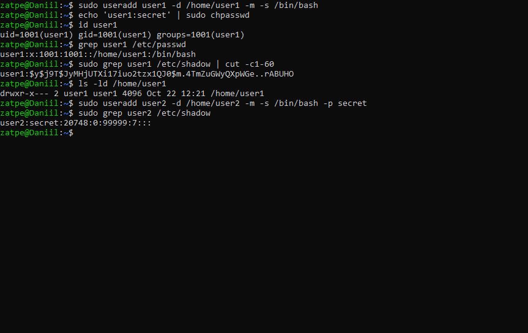
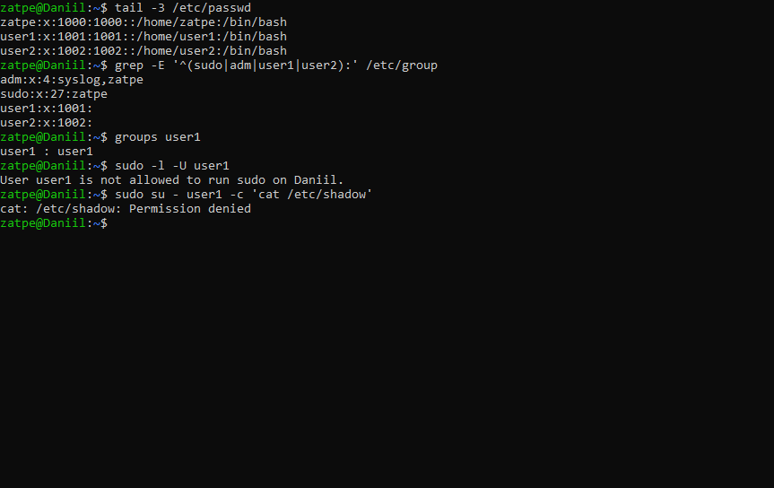
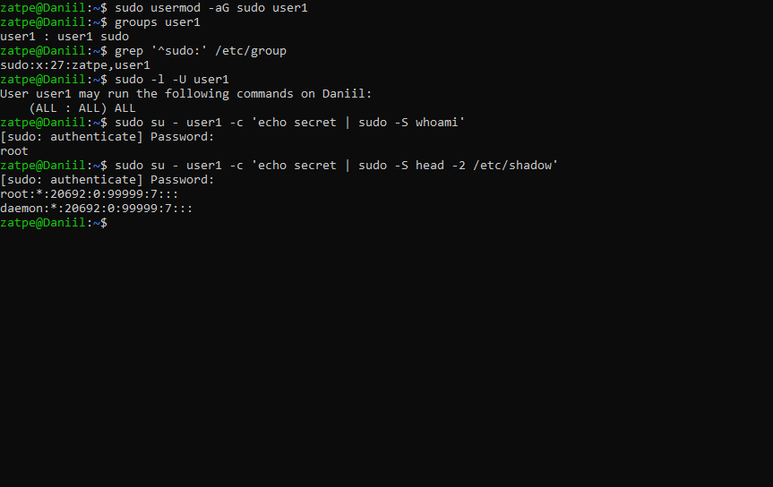
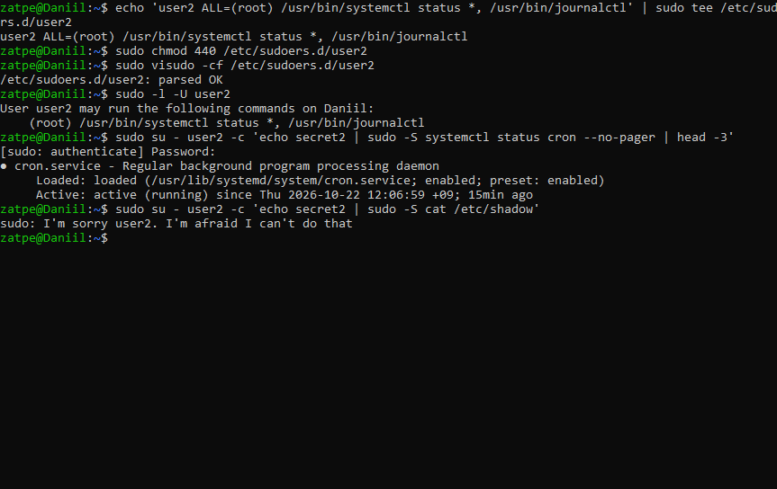
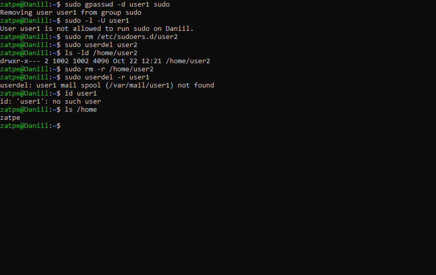

# Лабораторная работа №1. Привилегии

**Цель:** ознакомиться с методами управления привилегиями пользователей в Linux; научиться добавлять пользователей и назначать им права.

**Оборудование:** Ubuntu 26.04.1 LTS (WSL 2), хост `Daniil`.

## 1. Создание пользователя

Пользователь `user1` создан командой `useradd` с домашним каталогом (`-d`, `-m`) и оболочкой bash (`-s`). Пароль задан через `chpasswd`: он сохраняется в `/etc/shadow` в виде хеша yescrypt (`$y$…`).

Для сравнения `user2` создан так, как указано в методичке (`-p secret`). Ключ `-p` ожидает **уже готовый хеш**, поэтому в `/etc/shadow` попадает строка `secret` в открытом виде, и войти с паролем `secret` нельзя.

## 2. Файлы /etc/passwd и /etc/group

Формат `/etc/passwd`: `имя:x:UID:GID:комментарий:домашний_каталог:оболочка`. Пароль хранится не здесь, а в `/etc/shadow` (поле `x`).
Формат `/etc/group`: `группа:x:GID:список_участников`.

Изначально `user1` состоит только в своей группе, sudo ему запрещён, и прочитать `/etc/shadow` он не может.

## 3. Выдача прав администратора (группа sudo)

Правильный способ добавить пользователя в группу — `usermod -aG sudo user1` (ключ `-a` обязателен, иначе пользователь будет удалён из остальных дополнительных групп). Команда сама добавляет имя в строку группы в `/etc/group`: `sudo:x:27:zatpe,user1`.

После этого `sudo -l -U user1` показывает правило `(ALL : ALL) ALL`, и `user1` выполняет команды от root.

## 4. Ограниченные привилегии через sudoers

Чтобы дать пользователю права только на определённые команды, создан файл `/etc/sudoers.d/user2` (права `440`, проверка синтаксиса `visudo -cf`). `user2` может смотреть статус служб и журнал, но доступ к `/etc/shadow` ему запрещён.

## 5. Отзыв прав и удаление пользователей

`gpasswd -d user1 sudo` отзывает права администратора. `userdel` без ключей удаляет учётную запись, но **оставляет домашний каталог** (владелец становится «числовым» UID 1002). Для удаления вместе с каталогом нужен `userdel -r`.

## Замечания к методичке

* `useradd -p secret` не задаёт пароль `secret`, а записывает строку как хеш; пароль нужно задавать через `passwd` или `chpasswd`.
* Строка `user1:x:1000:1000:User1:/home/user1:/bin/bash` — это формат `/etc/passwd`, а не `/etc/group`. Редактировать эти файлы вручную не нужно: для групп есть `usermod -aG`, `gpasswd`, `vigr`.
* `userdel user1` не удаляет домашний каталог (см. скриншот 5).
* Команда `sudo rm -rf /` из примера уничтожает систему; на стенде она, разумеется, не выполнялась.

## Вывод

Освоены создание и удаление пользователей, назначение привилегий через группу `sudo` и точечная выдача прав через `/etc/sudoers.d`. Проверено, что без членства в `sudo` пользователь не может выполнять привилегированные команды, а ограниченное правило sudoers разрешает только перечисленные команды.
