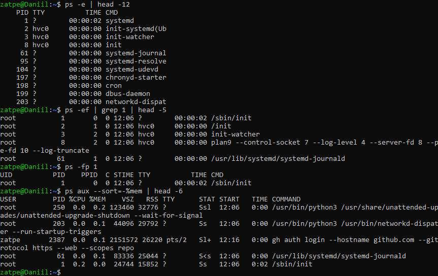
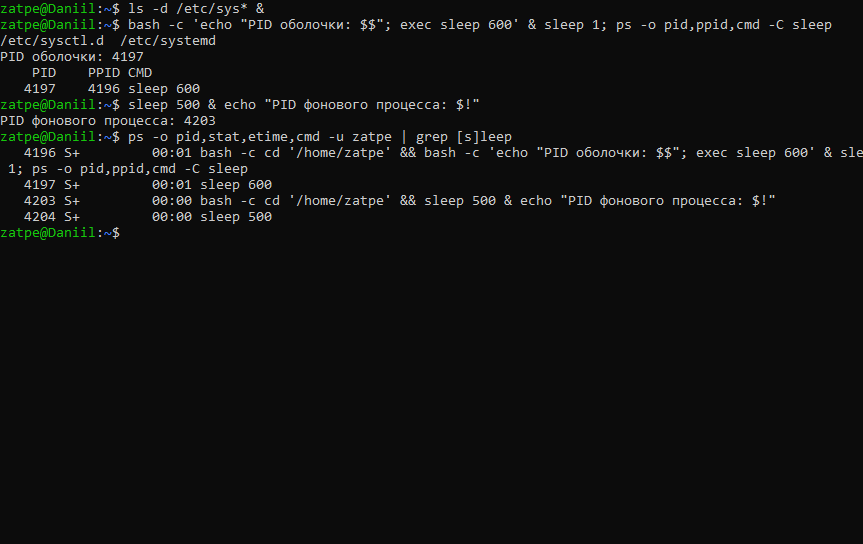
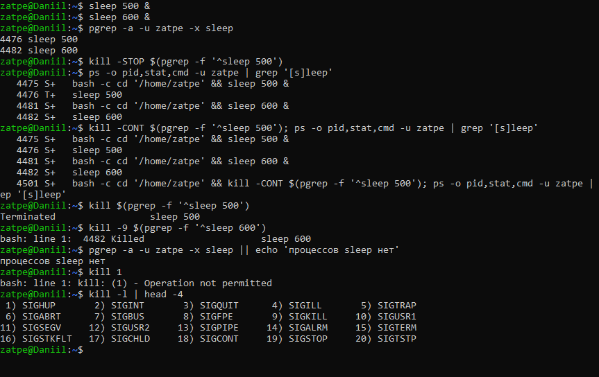
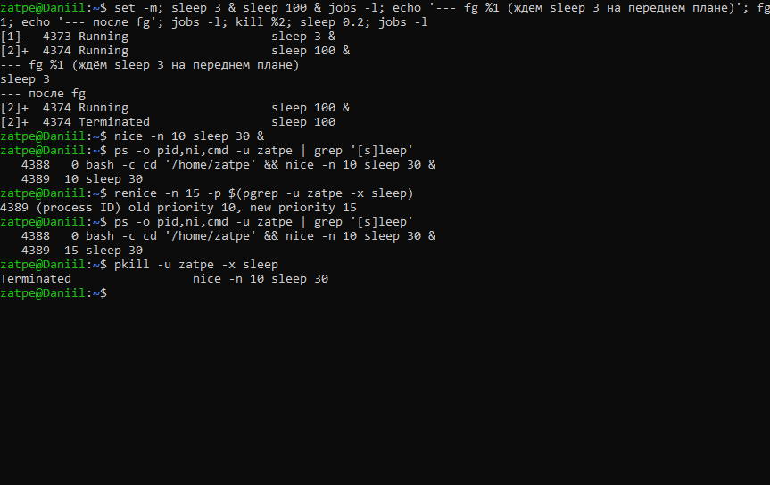
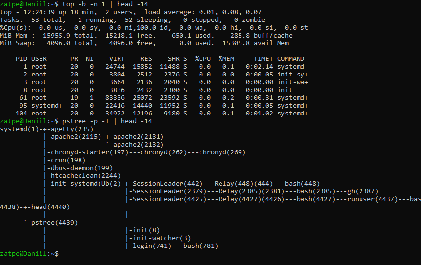

# Лабораторная работа №2. Управление процессами

**Цель:** ознакомиться с методами управления процессами в Linux; научиться получать информацию о процессах, запускать, останавливать и завершать их.

**Оборудование:** Ubuntu 26.04.1 LTS (WSL 2), хост `Daniil`.

## 1. Информация о процессах

`ps -e` выводит все процессы (PID, терминал, время ЦП, имя). `ps -ef` даёт полный формат с UID и PPID.
`ps -ef | grep 1` находит все строки, где встречается символ «1», а не процесс с PID 1. Для конкретного процесса правильно использовать `ps -fp 1`.
`ps aux --sort=-%mem` сортирует процессы по потреблению памяти.

## 2. Запуск процессов, exec и фоновый режим

* `команда &` запускает процесс в фоне; `$!` содержит его PID.
* `exec` **заменяет** текущий процесс новой программой без создания нового: на скриншоте у `sleep 600` тот же PID, что был у запустившей его оболочки.

## 3. Остановка и завершение процессов (сигналы)

* `kill -STOP` приостанавливает процесс (состояние `T`), `kill -CONT` возобновляет его.
* `kill PID` посылает `SIGTERM` (15) — корректное завершение.
* `kill -9 PID` посылает `SIGKILL` — немедленное завершение, которое процесс не может перехватить.
* `kill 1` от обычного пользователя даёт `Operation not permitted`: PID 1 — это `systemd`, его нельзя завершать.

## 4. Задания оболочки (jobs, fg) и приоритеты

`jobs -l` показывает фоновые задания текущей оболочки, `fg %1` возвращает задание №1 на передний план (аргумент `fg` — номер задания, а не PID).
`nice -n 10` запускает процесс с пониженным приоритетом, `renice` меняет приоритет уже работающего процесса.

## 5. Мониторинг: top и pstree

## Замечания к методичке

* `kill 1` / `kill -9 1` — попытка завершить `systemd`. Для демонстрации использовались процессы `sleep`.
* `exec vim` заменяет текущую оболочку редактором: после выхода из vim терминал закроется.
* Фоновые процессы видны в `ps` (на скриншоте 2 они есть); `jobs` показывает лишь задания текущей оболочки.
* `fg 1` — это задание №1, а не процесс с PID 1.

## Вывод

Получены навыки просмотра процессов (`ps`, `top`, `pstree`, `pgrep`), запуска процессов в фоне, управления ими сигналами (`SIGSTOP`, `SIGCONT`, `SIGTERM`, `SIGKILL`) и заданиями оболочки, изменения приоритета (`nice`, `renice`).
