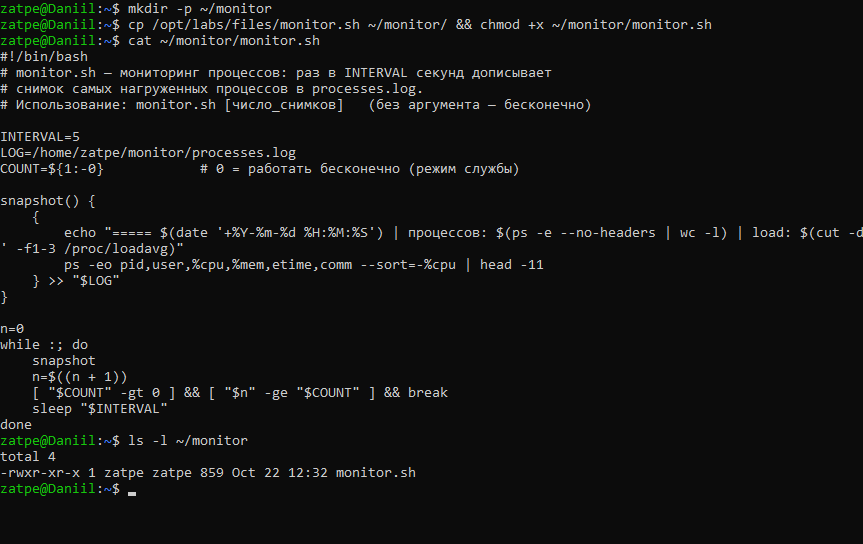
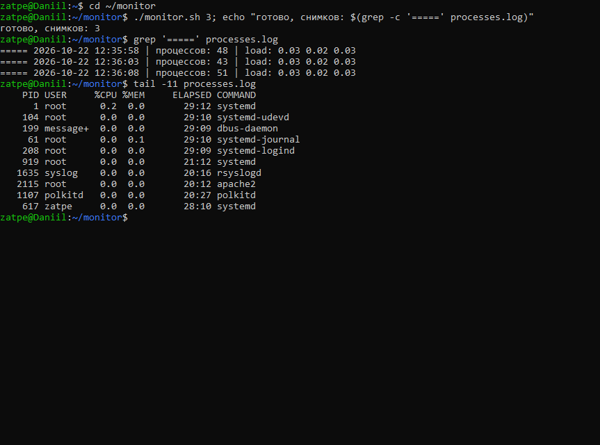
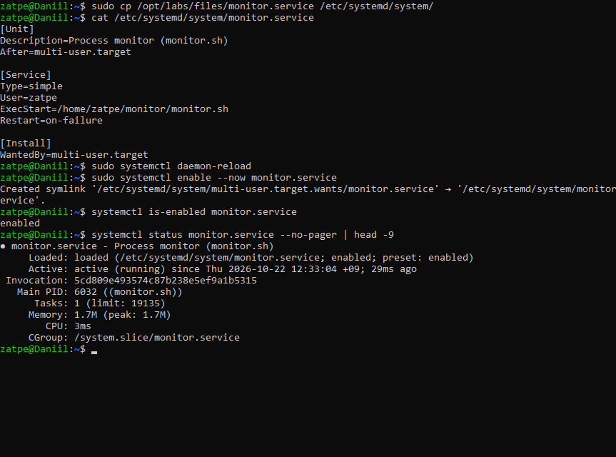
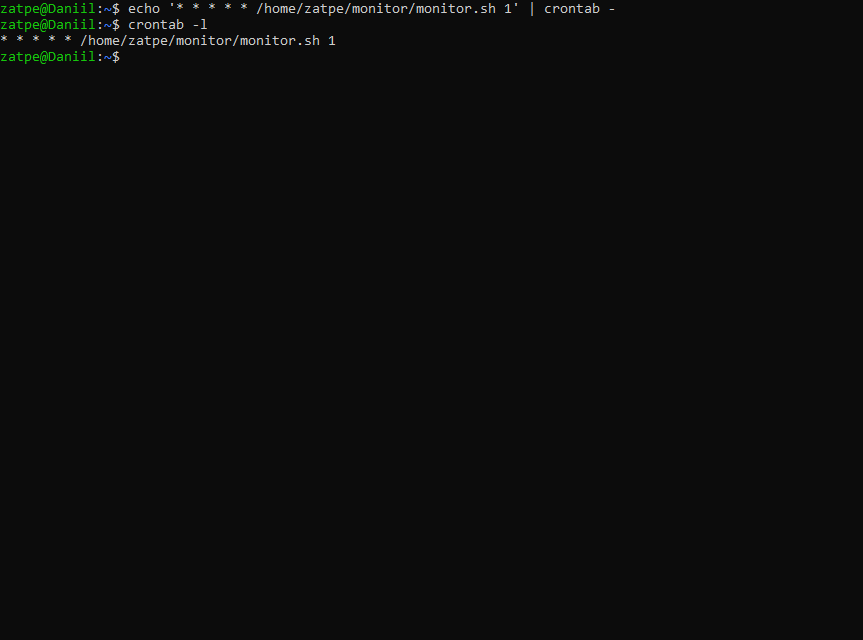
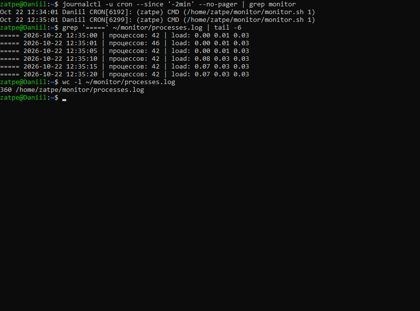
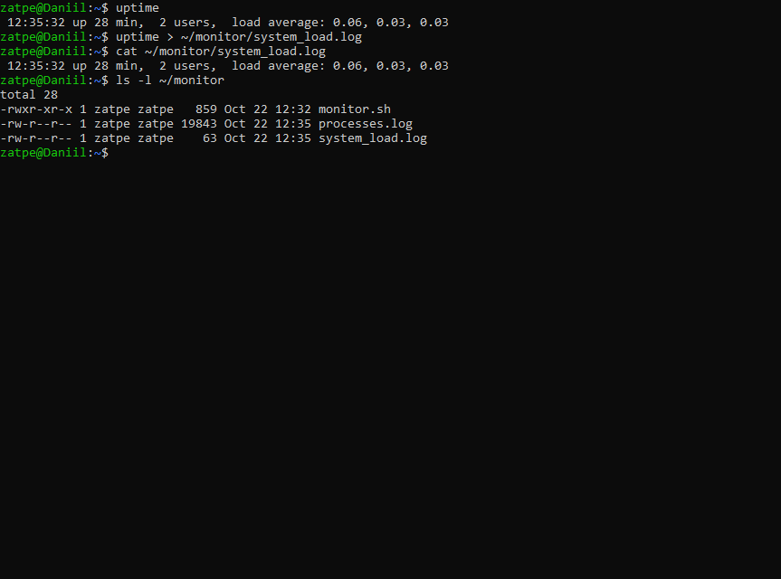

# Лабораторная работа №3. Monitor

**Задание:**
1. Создать скрипт `monitor.sh`, который каждые 5 секунд выводит информацию о запущенных процессах и сохраняет её в `processes.log`.
2. Добавить `monitor.sh` в автозагрузку системы.
3. Создать cron-задачу, запускающую `monitor.sh` каждую минуту с записью в `processes.log`.
4. Проверить загрузку системы командой `uptime` и сохранить результат в `system_load.log`.

**Оборудование:** Ubuntu 26.04.1 LTS (WSL 2), хост `Daniil`.

## 1. Скрипт monitor.sh

Исходный код: [monitor.sh](monitor.sh). Скрипт раз в 5 секунд дописывает в `~/monitor/processes.log` заголовок (дата, число процессов, load average) и 10 самых загруженных по ЦП процессов.
Необязательный аргумент — число снимков: без аргумента скрипт работает бесконечно (режим службы), `monitor.sh 1` делает один снимок (режим для cron).

Проверка: три снимка с интервалом 5 секунд.

## 2. Автозагрузка (systemd)

Создан unit-файл [monitor.service](monitor.service) с `WantedBy=multi-user.target` и включён командой `systemctl enable --now`. Служба запускается при каждом старте системы (проверено перезапуском дистрибутива: служба поднялась автоматически).

## 3. Задача cron

Если cron будет каждую минуту запускать бесконечный цикл, то копии скрипта накопятся. Поэтому cron вызывает скрипт с аргументом `1` — один снимок в минуту.

Через две минуты в журнале cron видны запуски `monitor.sh 1` в 12:34:01 и 12:35:01, а в `processes.log` — записи (снимки каждые 5 секунд от службы плюс ежеминутные от cron).

## 4. Загрузка системы

`uptime` показывает текущее время, время работы, число пользователей и среднюю загрузку за 1, 5 и 15 минут.

## Вывод

Создан скрипт мониторинга процессов. Он запускается тремя способами: вручную, как служба systemd с автозапуском и по расписанию cron. Результаты пишутся в `processes.log`, загрузка системы сохранена в `system_load.log`.
