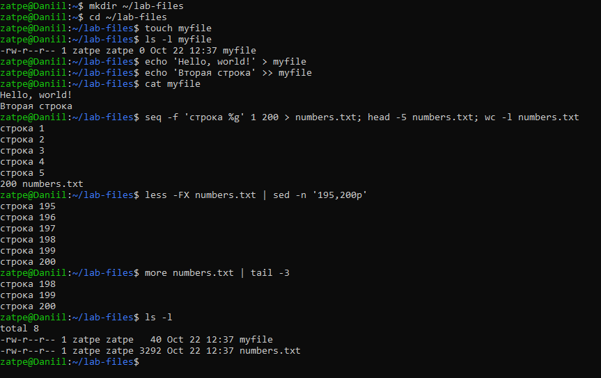
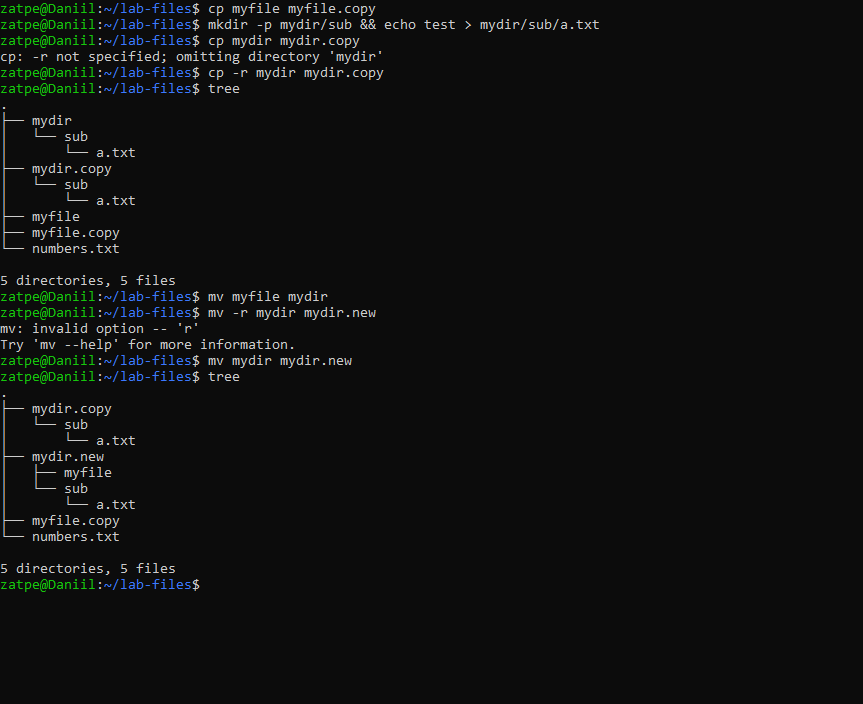
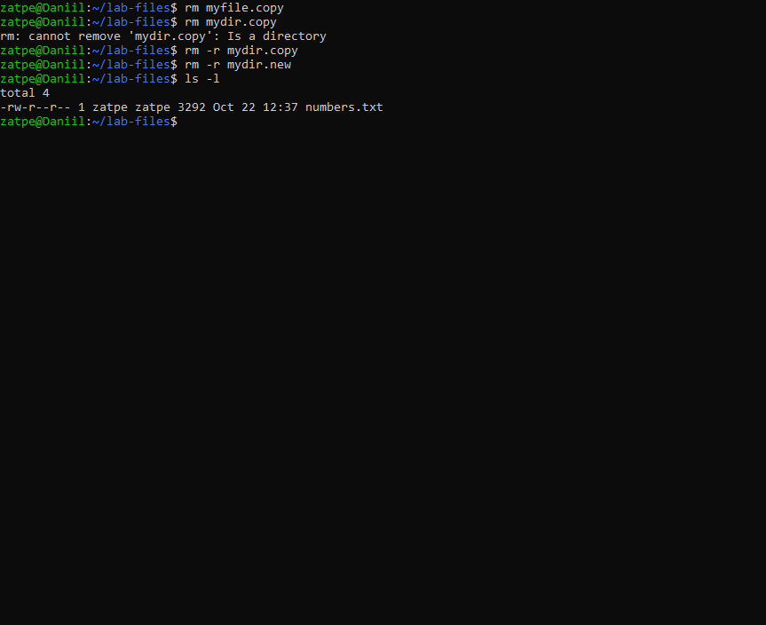
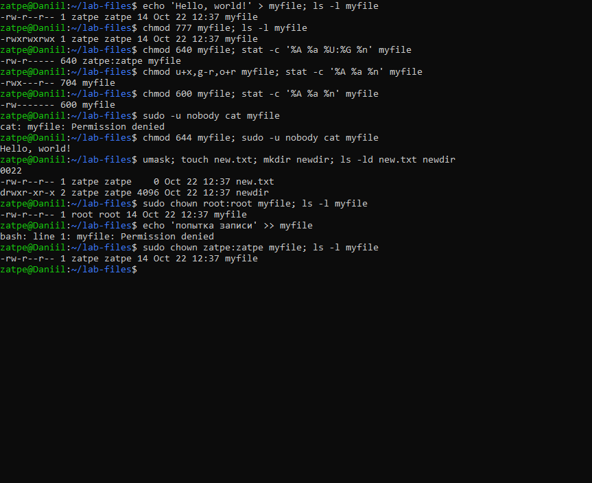

# Лабораторная работа №4. Работа с файлами

**Цель:** ознакомиться с основными командами для работы с файлами; научиться создавать, просматривать, копировать, перемещать, удалять файлы и изменять права доступа.

**Оборудование:** Ubuntu 26.04.1 LTS (WSL 2), хост `Daniil`.

## 1. Создание и просмотр файлов

`touch` создаёт пустой файл, `>` перезаписывает файл, `>>` дописывает в конец. Для просмотра используются `cat`, `head`, `tail`, постраничный просмотр — `less` и `more`.

## 2. Копирование и перемещение

`cp` без `-r` не копирует каталоги (`-r not specified; omitting directory`), с ключом `-r` копирует рекурсивно.
`mv` перемещает и переименовывает как файлы, так и каталоги **без** дополнительных ключей. Ключа `-r` у `mv` нет (`invalid option -- 'r'`).

## 3. Удаление

`rm` удаляет файлы. Каталог удаляется только с `-r` (без него — ошибка `Is a directory`).

## 4. Права доступа

Права записываются тремя восьмеричными цифрами: владелец, группа, остальные. Каждая цифра — сумма: **r = 4, w = 2, x = 1** (0 — нет прав).
Например, `640` = `rw-r-----`, `777` = `rwxrwxrwx`. Символьная форма: `chmod u+x,g-r,o+r`.

На скриншоте:
* при `600` пользователь `nobody` не может прочитать файл, при `644` — может;
* `umask 0022` объясняет права новых файлов (`644`) и каталогов (`755`);
* после `chown root:root` владелец сменился, и пользователь `zatpe` больше не может писать в файл.

## Замечания к методичке

* Значения прав указаны неверно: должно быть r = 4, w = 2, x = 1 (в методичке — «1 — чтение, 4 — выполнение»). Цифры прав записываются подряд (`755`), без двоеточий.
* У `mv` нет ключа `-r`: каталоги перемещаются без него (см. скриншот 2).

## Вывод

Освоены команды работы с файлами и каталогами (`touch`, `cat`, `less`, `cp`, `mv`, `rm`), а также управление правами доступа (`chmod` в числовой и символьной форме, `chown`, `umask`). На практике проверено, как права ограничивают доступ других пользователей.
