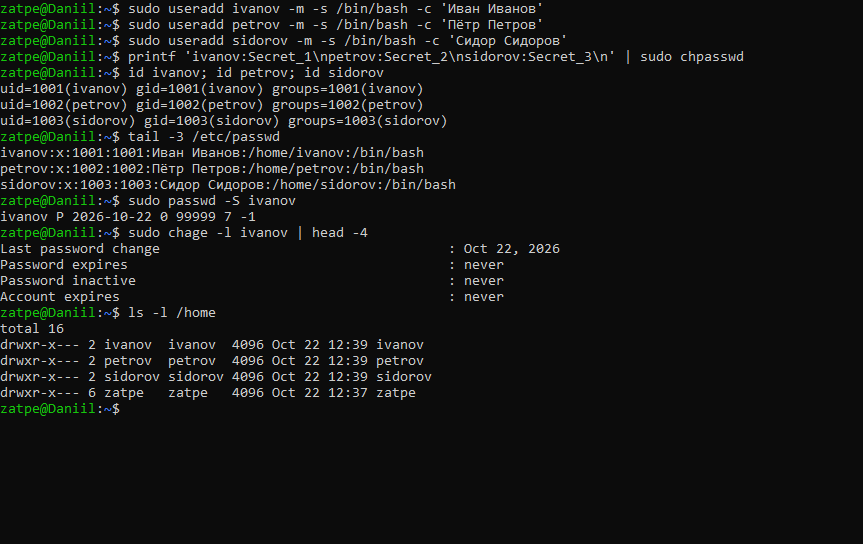
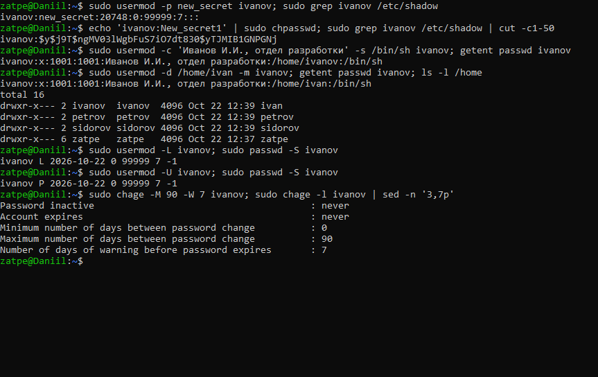
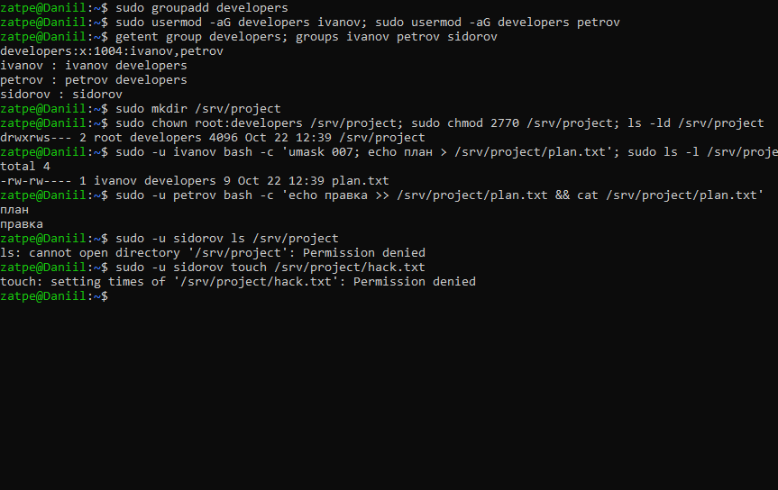
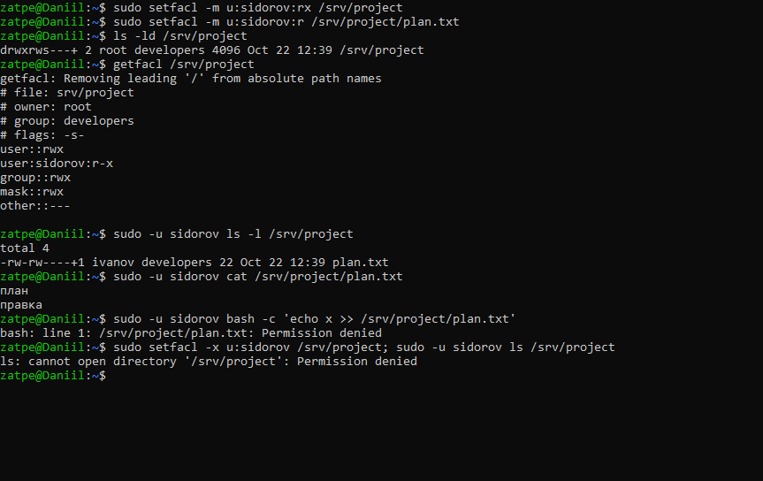
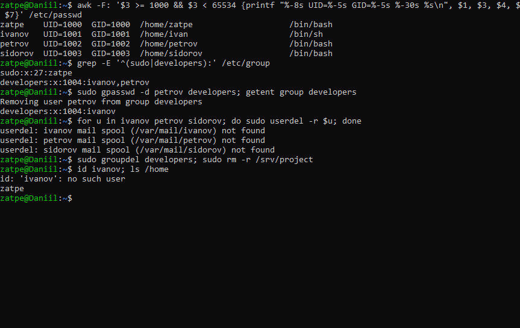

# Лабораторная работа №5. Работа с пользователями

**Цель:** ознакомиться с командами для работы с пользователями; научиться создавать, удалять, изменять пользователей и управлять их правами.

**Оборудование:** Ubuntu 26.04.1 LTS (WSL 2), хост `Daniil`.

## 1. Создание пользователей

Созданы три пользователя с комментарием (полным именем) и паролями. Состояние пароля проверяется командами `passwd -S` и `chage -l`.

## 2. Изменение пользователей (usermod, chage)

* `usermod -p new_secret` записывает строку в `/etc/shadow` как есть, без хеширования (видно на скриншоте). Правильная смена пароля — `passwd` или `chpasswd`.
* `usermod -c` меняет комментарий, `-s` — оболочку, `-d … -m` — домашний каталог с переносом файлов.
* `usermod -L` / `-U` блокирует и разблокирует учётную запись (статус `L` / `P`).
* `chage -M 90 -W 7` — срок действия пароля 90 дней, предупреждение за 7 дней.

## 3. Разграничение доступа через группы

Создана группа `developers` (ivanov, petrov) и общий каталог `/srv/project` с правами `2770`:
* `770` — полный доступ владельцу и группе, остальным — никакого;
* бит **SGID** (`2`) — новые файлы получают группу каталога (`developers`), а не основную группу автора.

ivanov и petrov совместно редактируют `plan.txt`, а sidorov не может ни просмотреть каталог, ни создать в нём файл.

## 4. Точечный доступ через ACL

Чтобы дать sidorov доступ только на чтение, не включая его в группу, использованы списки ACL: `setfacl -m u:sidorov:rx` для каталога и `u:sidorov:r` для файла. Признак ACL — `+` в выводе `ls -l`. sidorov читает файл, но писать не может. После `setfacl -x` доступ снова закрыт.

## 5. Информация о пользователях и удаление

Список обычных пользователей (UID ≥ 1000) получен из `/etc/passwd`; удаление из группы — `gpasswd -d`, удаление пользователей — `userdel -r`, группы — `groupdel`.

## Замечания к методичке

* `usermod -p` и `useradd -p` принимают хеш, а не пароль (см. скриншот 2).
* Строка `user1:x:1000:1000:User1:/home/user1:/bin/bash:sudo` не является корректной ни для `/etc/group`, ни для `/etc/passwd`. Пользователь добавляется в группу командой `usermod -aG sudo user1`.
* Пароли хранятся в `/etc/shadow`, а не в `/etc/passwd`.

## Вывод

Освоено управление учётными записями (`useradd`, `usermod`, `chage`, `passwd`, `userdel`) и разграничение доступа: стандартные права, группы с SGID-каталогом и списки ACL для индивидуальных прав.
