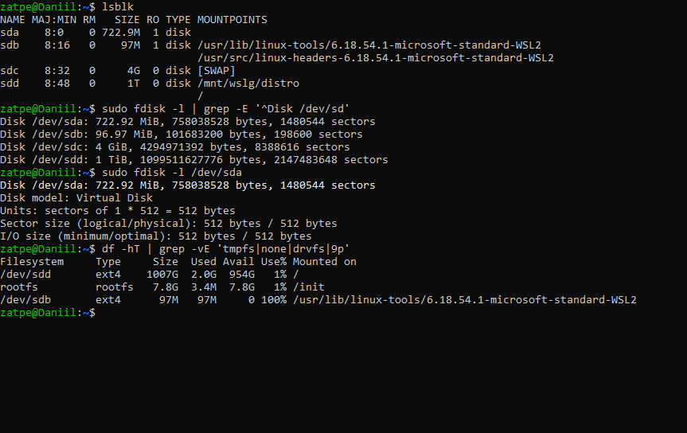
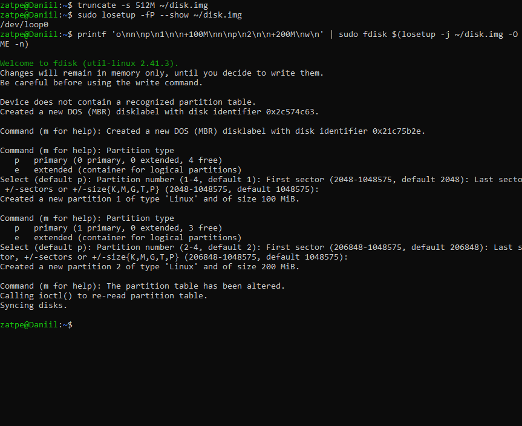
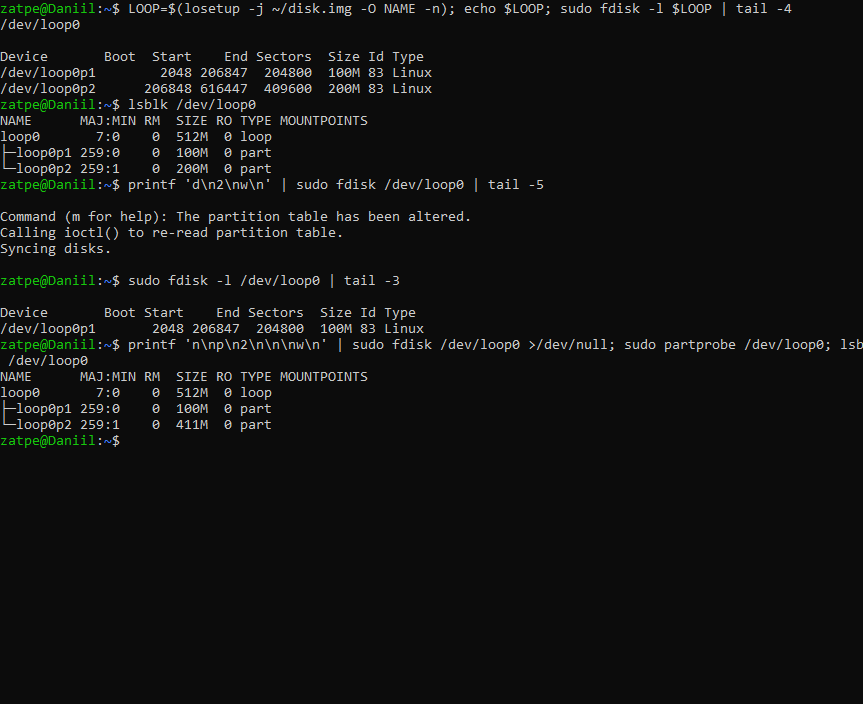
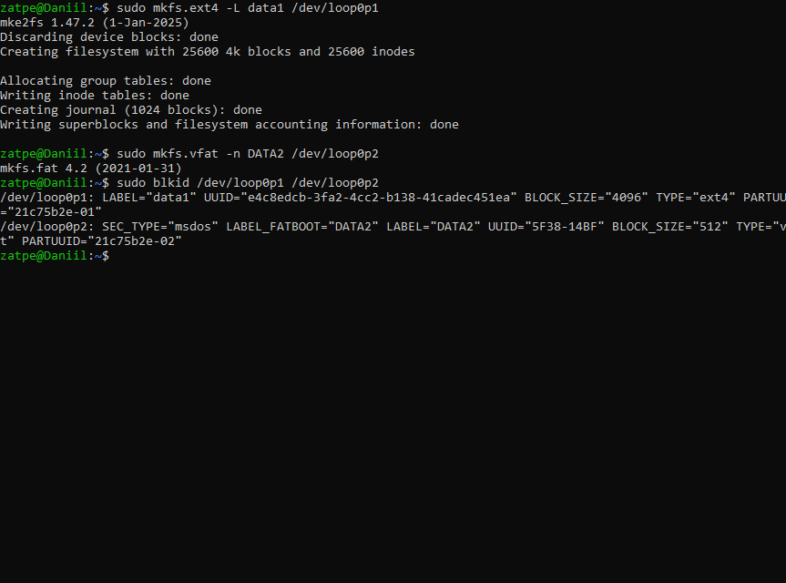
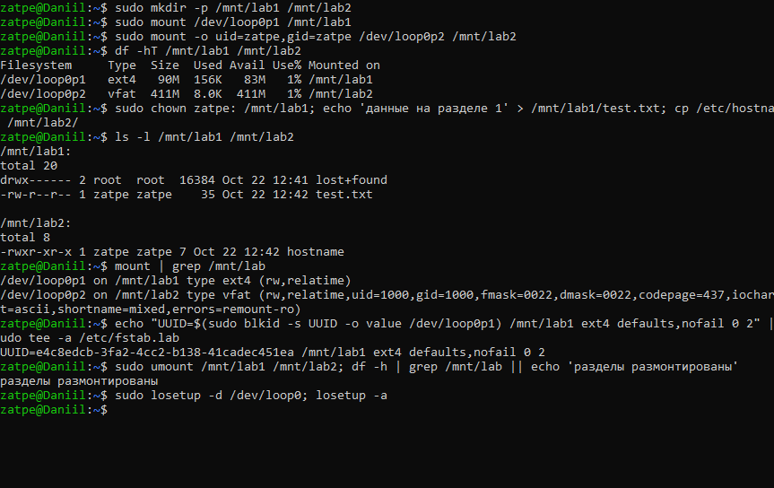

# Лабораторная работа №6. Работа с дисками

**Цель:** ознакомиться с командами для работы с дисками; научиться получать информацию о дисках, создавать и удалять разделы, создавать файловые системы и монтировать их.

**Оборудование:** Ubuntu 26.04.1 LTS (WSL 2), хост `Daniil`.

Системные диски WSL (`/dev/sda`…`/dev/sdd`) использует сама система, поэтому разметка выполнялась на **виртуальном диске**: файл-образ 512 МБ, подключённый как блочное устройство `/dev/loop0` (`losetup`). Для `fdisk` и `mkfs` это обычный диск.

## 1. Информация о дисках

## 2. Создание разделов (fdisk)

В `fdisk` выполнены команды: `o` (новая таблица MBR), `n` → `p` → `1` → Enter → `+100M` (первичный раздел 100 МБ), то же для раздела 2 на 200 МБ, затем `w` (запись таблицы).

## 3. Удаление раздела

`d` → `2` → `w` удаляет раздел 2. Затем он создан заново на всё оставшееся место (411 МБ).

## 4. Форматирование (создание файловых систем)

`mkfs.ext4` для раздела 1 и `mkfs.vfat` для раздела 2; `blkid` показывает тип ФС, метку и UUID.

## 5. Монтирование

Разделы смонтированы в `/mnt/lab1` и `/mnt/lab2`, на них записаны файлы, затем размонтированы. Для автоматического монтирования при загрузке сформирована строка `/etc/fstab` по UUID.

## Замечания к методичке

* После `n` и `p` fdisk спрашивает номер раздела и **первый сектор**, и только потом размер, который вводится как `+100M` (не `100M`).
* Изменения сохраняются командой `w`, а не Enter; `w` одновременно записывает таблицу и выходит из fdisk (выход без сохранения — `q`).
* Пункты «Форматирование» и «Создание файловых систем» — одно и то же действие (`mkfs`).

## Вывод

Получены навыки просмотра дисков и разделов (`lsblk`, `fdisk -l`, `blkid`, `df`), создания и удаления разделов в `fdisk`, создания файловых систем ext4 и FAT, монтирования и размонтирования разделов.
