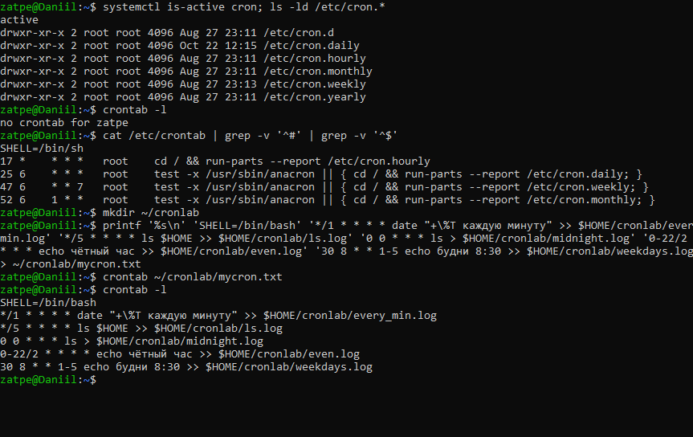
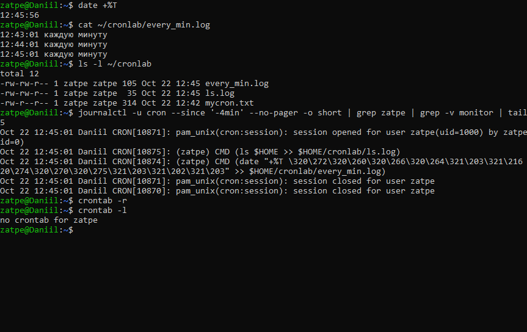

# Лабораторная работа №7. Автоматизация периодического выполнения процессов

**Цель:** ознакомиться с методами автоматизации периодического выполнения процессов; научиться создавать и использовать crontab.

**Оборудование:** Ubuntu 26.04.1 LTS (WSL 2), хост `Daniil`.

## 1. Создание crontab

Служба `cron` активна; системные задания находятся в `/etc/crontab` и каталогах `/etc/cron.*`. Пользовательский crontab изначально пуст.
Формат строки: `минуты часы день_месяца месяц день_недели команда`.

Вместо интерактивного `crontab -e` расписание записано в файл и загружено командой `crontab файл` (результат тот же):

| Строка | Смысл |
|---|---|
| `*/1 * * * *` | каждую минуту |
| `*/5 * * * *` | каждые 5 минут (пример `ls` из методички) |
| `0 0 * * *` | каждый день в 00:00 |
| `0-22/2 * * * *` | каждые 2 минуты в интервале 0–22 мин. каждого часа |
| `30 8 * * 1-5` | в 8:30 по будням (пн–пт) |

## 2. Проверка выполнения и удаление

Через 3 минуты в `every_min.log` есть записи за 12:43, 12:44 и 12:45, в журнале cron — соответствующие запуски. `crontab -r` удаляет расписание пользователя.

## Замечания к методичке

* `-` в crontab задаёт **диапазон** (`1-5`), а не «больше или равно»; символа `+` в синтаксисе crontab нет; `/` задаёт шаг.
* `0-23 * * * *` запускает команду в минуты 0–23 каждого часа, а не «каждый час». Для запуска раз в час в начале часа: `0 * * * *`; каждые 2 часа: `0 */2 * * *`; каждые 3 часа: `0 */3 * * *`.
* Часов «24:00» в crontab нет: допустимые значения часов — 0–23.
* Символ `%` в команде crontab нужно экранировать (`\%`).

## Вывод

Освоен формат crontab, создание, просмотр и удаление пользовательского расписания. Выполнение заданий подтверждено файлами результатов и журналом службы cron.
