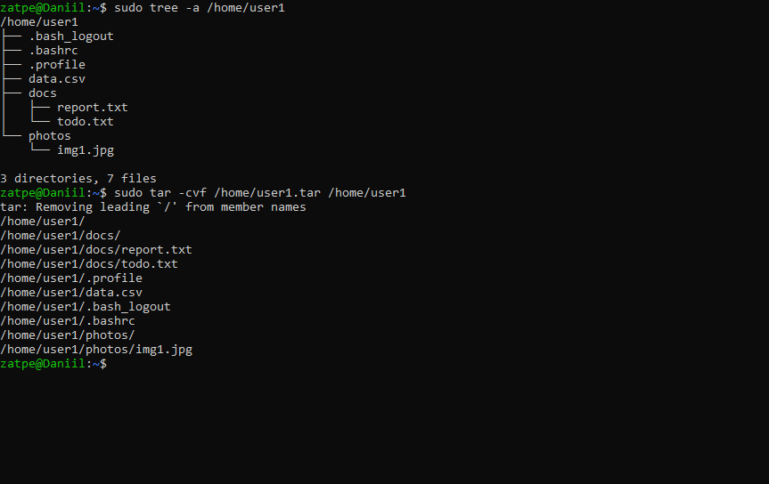
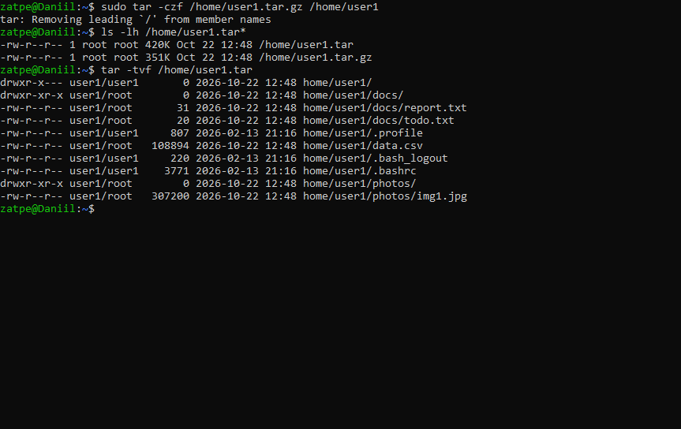
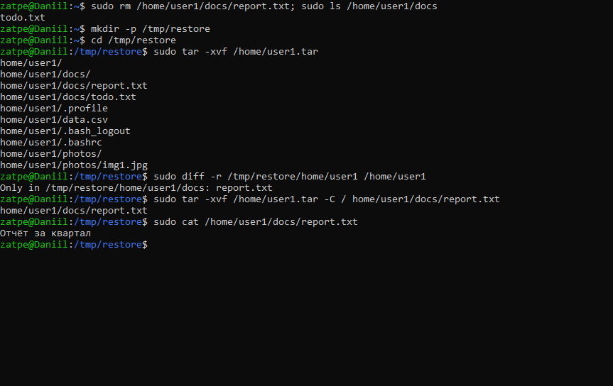
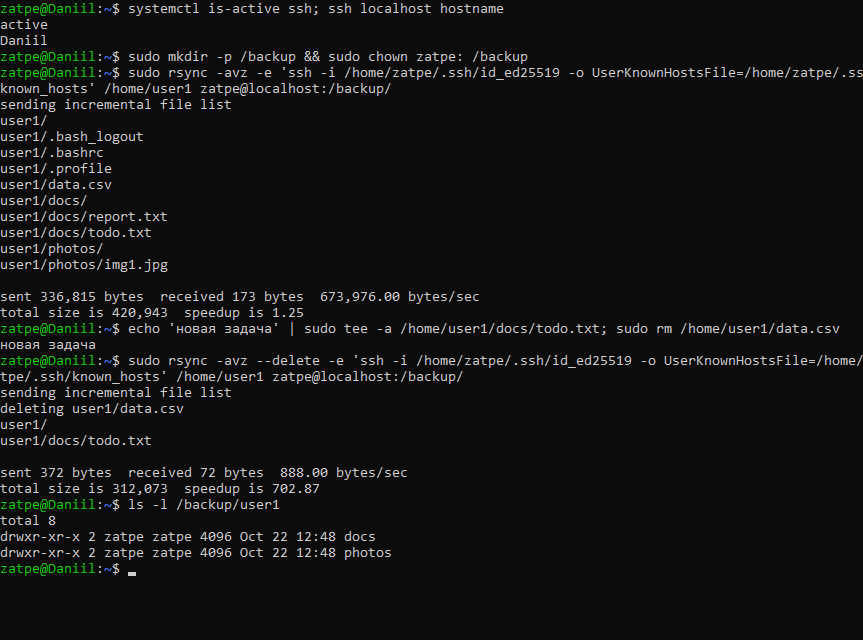
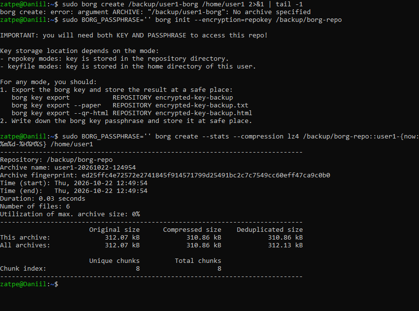
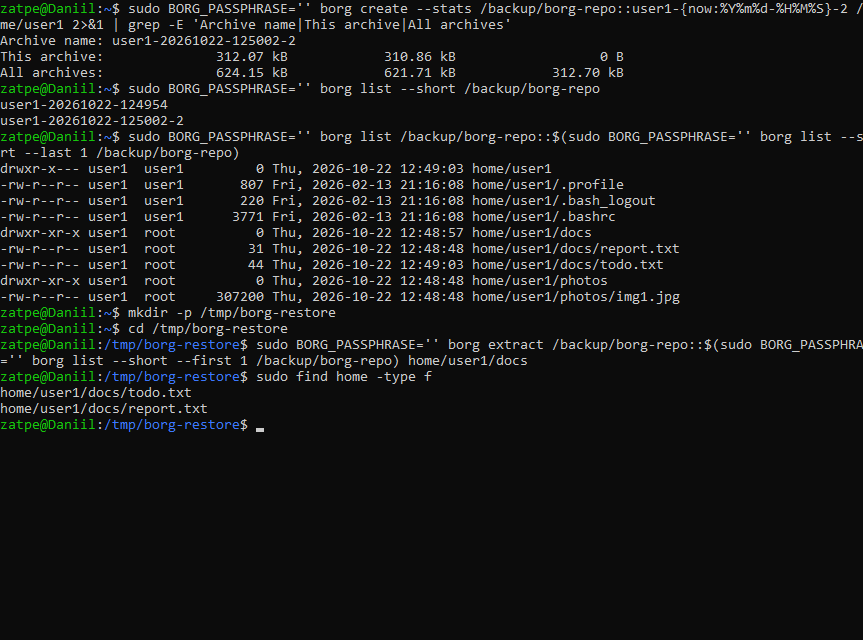
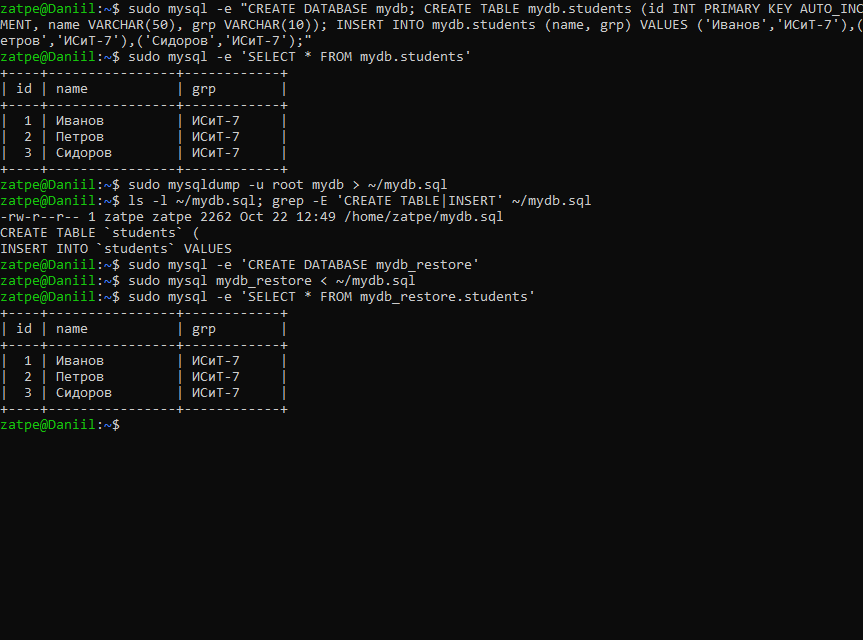
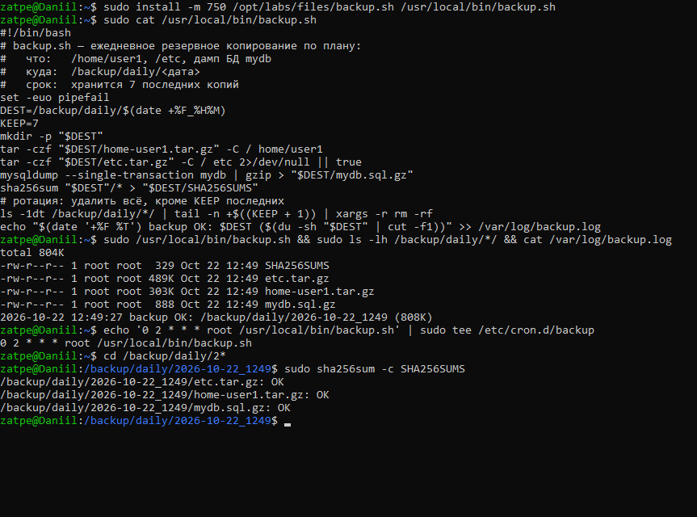

# Лабораторная работа №8. Резервное копирование

**Цель:** ознакомиться с методами резервного копирования в Linux; научиться создавать резервные копии файлов, каталогов и баз данных.

**Оборудование:** Ubuntu 26.04.1 LTS (WSL 2), хост `Daniil`; MariaDB 11; borgbackup; rsync + OpenSSH.

## 1. tar: создание архива

Подготовлен каталог `/home/user1` с документами, «фотографией» и данными.
`tar -cvf` создаёт архив без сжатия, `tar -czf` — со сжатием gzip, `tar -tvf` показывает содержимое архива.

## 2. tar: восстановление

Удалён файл `report.txt`. Архив распакован в `/tmp/restore` (`tar -xvf` распаковывает в текущий каталог); `diff` показывает, чего не хватает в оригинале. Затем из архива восстановлен только удалённый файл (`-C /` и путь к файлу).

## 3. rsync на удалённый сервер

В роли удалённого сервера используется SSH-сервер (`zatpe@localhost`). Команда та же, что для настоящего удалённого хоста, меняется только адрес.
Первый запуск передаёт всё, второй — только изменения (`speedup is 704`), `--delete` удаляет в копии файлы, удалённые в источнике.

## 4. borg: дедуплицирующее резервное копирование

Команда из методички `borg create /backup/user1 /home/user1` не работает: borg требует сначала создать репозиторий (`borg init`) и указать имя архива (`репозиторий::архив`).
Второй архив тех же данных занимает **0 B** — borg хранит только новые блоки (дедупликация).

## 5. Резервное копирование БД (mysqldump)

Создана БД `mydb` с таблицей `students`; `mysqldump` сохраняет её в SQL-файл (команды `CREATE TABLE` и `INSERT`). Восстановление проверено загрузкой дампа в новую БД `mydb_restore`.

## 6. План резервного копирования

| Параметр | Значение |
|---|---|
| Частота | ежедневно в 02:00 (`/etc/cron.d/backup`) |
| Что копируется | `/home/user1`, `/etc`, дамп БД `mydb` |
| Куда | `/backup/daily/<дата_время>/`; дополнительно копия на удалённый сервер через rsync |
| Хранение | 7 последних копий (ротация в скрипте) |
| Контроль целостности | `SHA256SUMS` в каждой копии, проверка `sha256sum -c` |
| Восстановление | `tar -xzf … -C /` для файлов, `gunzip < mydb.sql.gz \| mysql mydb` для БД |

Скрипт: [backup.sh](backup.sh).

## Вывод

Освоены инструменты резервного копирования: `tar` (полные архивы), `rsync` (инкрементальная синхронизация на удалённый хост), `borg` (дедупликация, версии архивов), `mysqldump` (резервные копии БД). Составлен и автоматизирован план резервного копирования с ротацией и контролем целостности.
