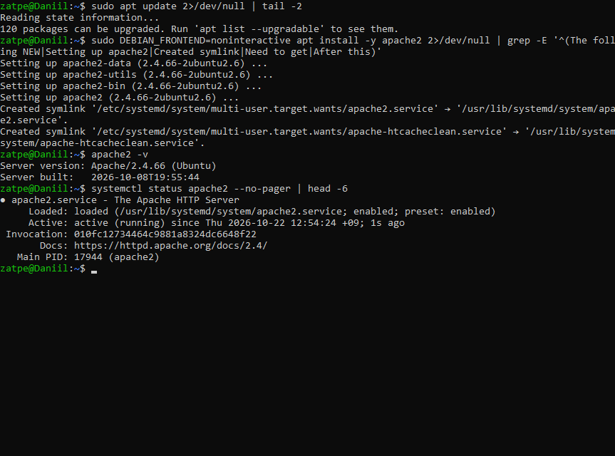
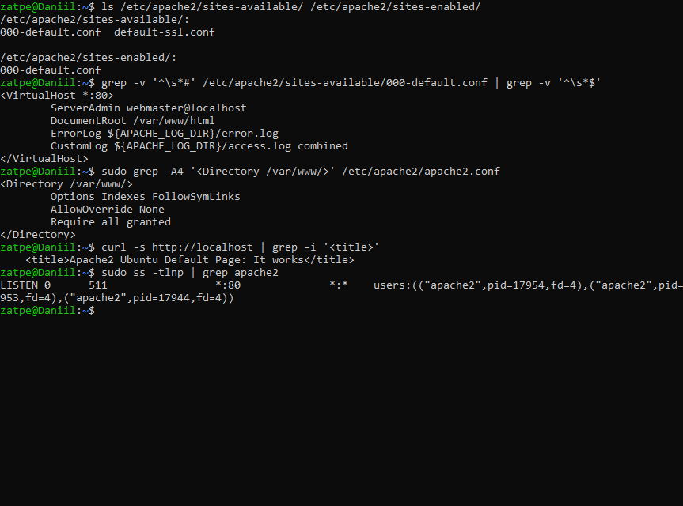
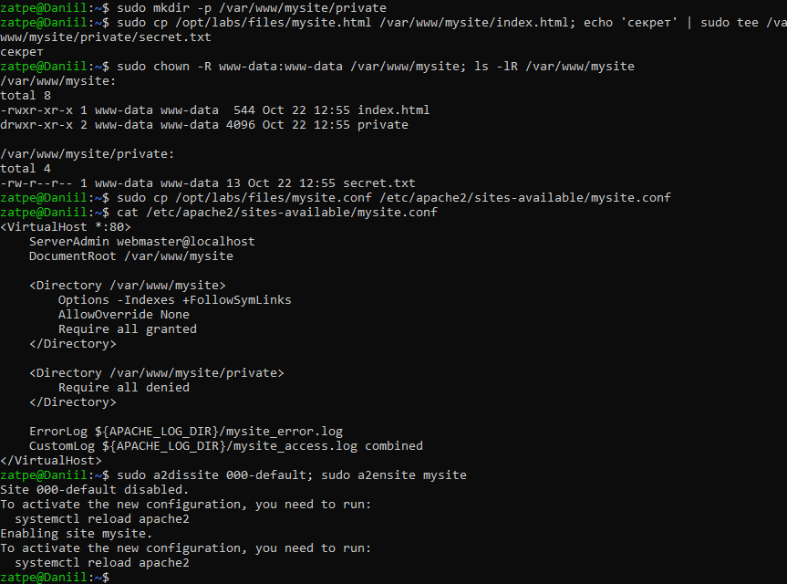
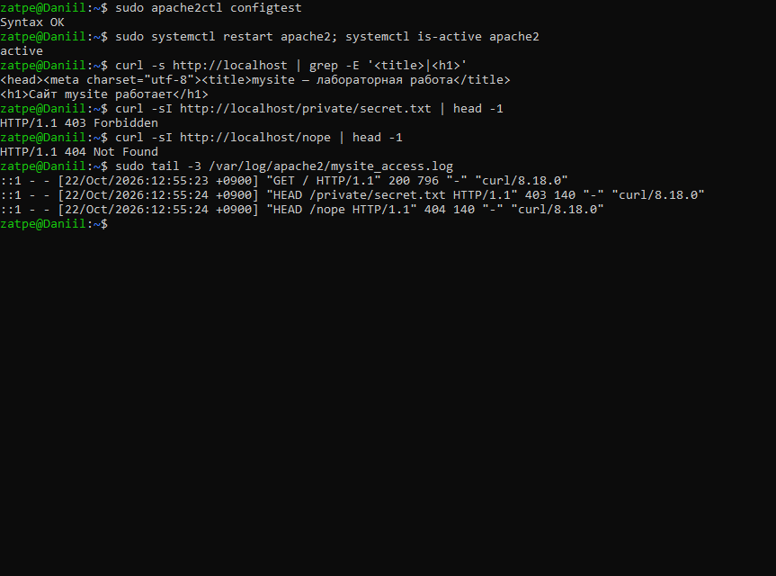
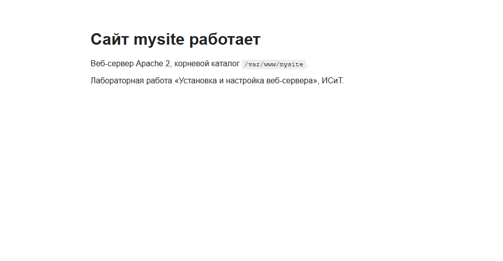
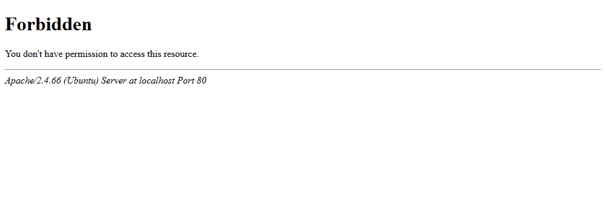

# Лабораторная работа №9. Установка и настройка веб-сервера

**Цель:** ознакомиться с веб-серверами Linux (Apache, Nginx, Lighttpd); научиться устанавливать и настраивать Apache.

**Оборудование:** Ubuntu 26.04.1 LTS (WSL 2), хост `Daniil`.

## 1. Установка Apache

`apt update` и `apt install apache2`; после установки служба сразу запущена и добавлена в автозагрузку.

## 2. Исходная конфигурация

В Ubuntu конфигурация сайта по умолчанию — `/etc/apache2/sites-available/000-default.conf` (файла `default` нет), а блок `<Directory /var/www/>` с правами находится в `/etc/apache2/apache2.conf`. Сервер слушает порт 80 и отдаёт стандартную страницу «It works».

## 3. Настройка собственного сайта

* Корневой каталог `/var/www/mysite` со страницей [index.html](index.html), владелец `www-data`.
* Виртуальный хост [mysite.conf](mysite.conf): `DocumentRoot /var/www/mysite`, `AllowOverride None`, `Require all granted`, отключён листинг каталогов (`-Indexes`).
* Разграничение доступа: для `/var/www/mysite/private` — `Require all denied`.
* Сайт включён через `a2ensite mysite`, стандартный отключён через `a2dissite 000-default`.

## 4. Проверка

`apache2ctl configtest` → `Syntax OK`, перезапуск службы. Главная страница отдаётся (200), закрытый каталог — `403 Forbidden`, несуществующий путь — `404`. Обращения видны в журнале доступа.

Проверка в браузере (Microsoft Edge в Windows, `http://localhost`):

## Замечания к методичке

* В Ubuntu файл называется `sites-available/000-default.conf`; блок `<Directory>` по умолчанию находится в `apache2.conf`.
* Правильнее не править конфигурацию по умолчанию, а создать отдельный виртуальный хост и включить его через `a2ensite`, проверив синтаксис `apache2ctl configtest`.

## Вывод

Установлен и настроен веб-сервер Apache 2.4: создан виртуальный хост со своим корневым каталогом, настроены права доступа к каталогам (разрешение и запрет), проверена работа сервера через `curl` и браузер.
