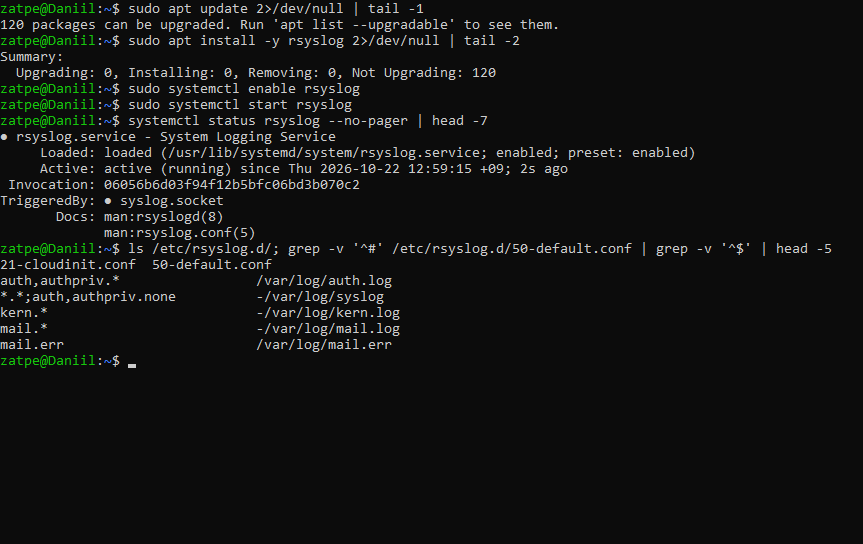
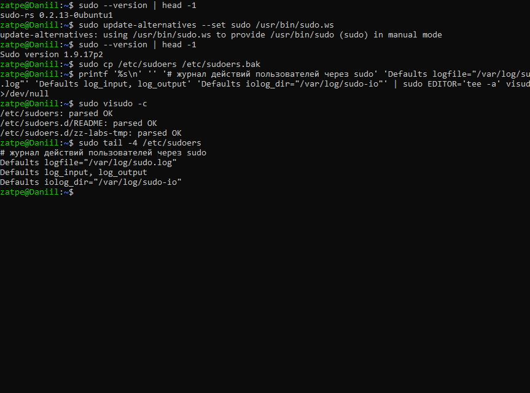
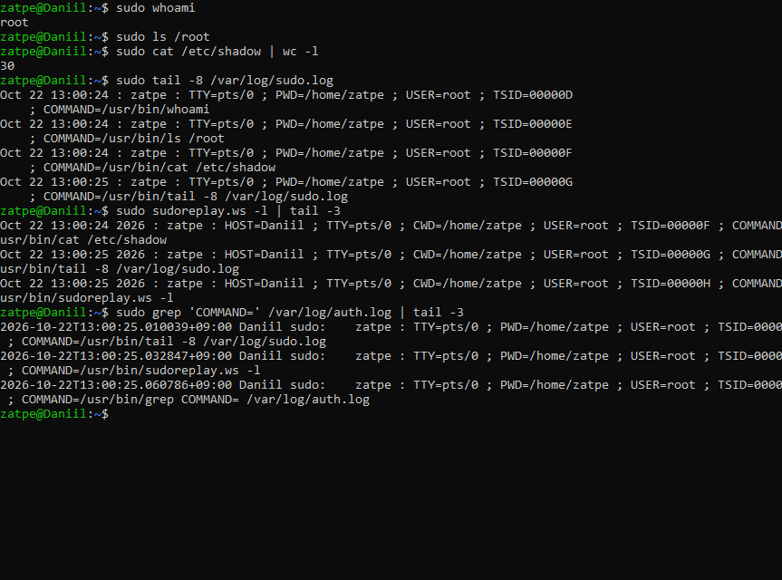
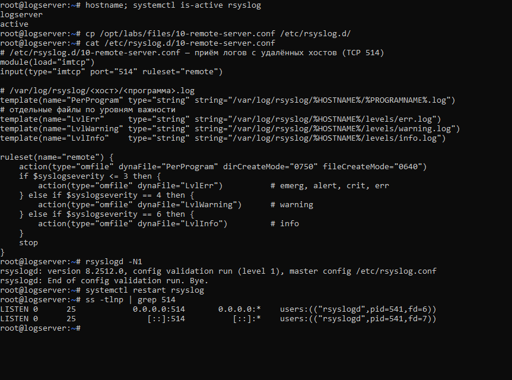
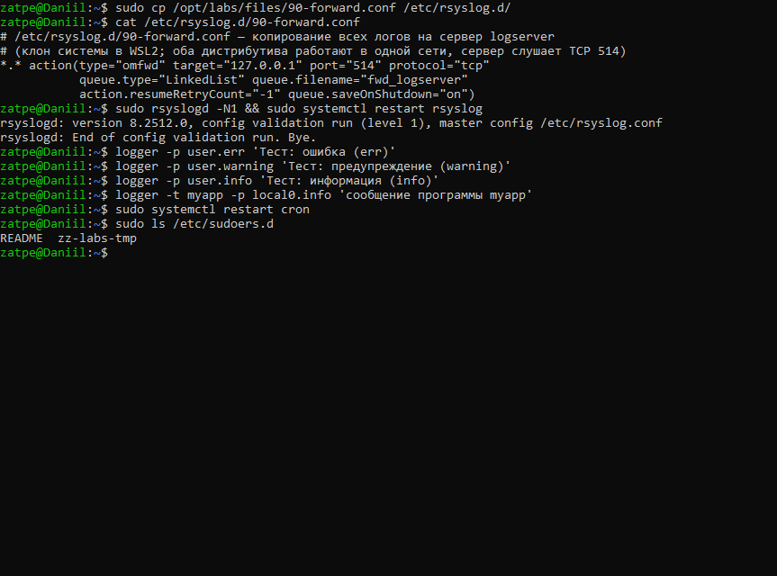
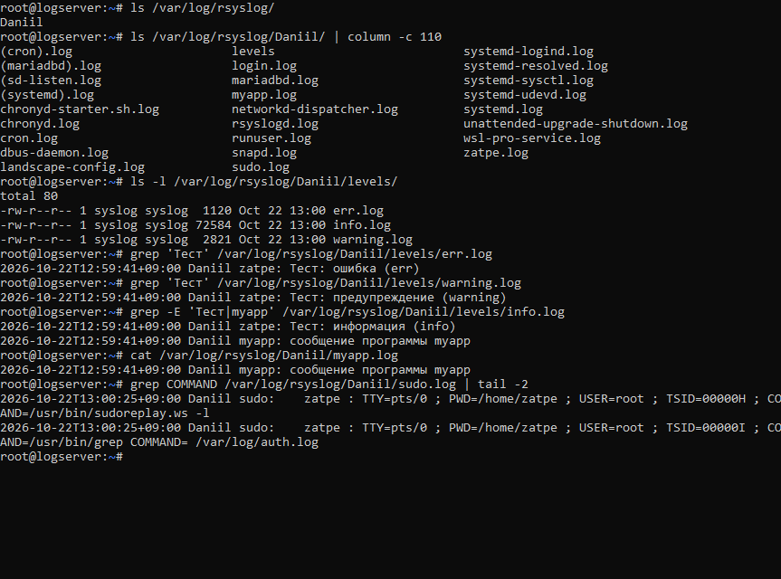

# Лабораторная работа №10. Логи

**Задание:**
1. Установить и включить пакет rsyslog.
2. Добавить журналирование действий пользователя (sudo) в файле `/etc/sudoers`.
3. Настроить копирование логов на удалённый сервер (клон системы); на сервере файлы должны лежать по шаблону `/var/log/rsyslog/%HOSTNAME%/%PROGRAMNAME%.log`.
4. Сделать так, чтобы разные уровни логов (err, warning, info) писались в разные файлы.

**Стенд:** клиент — Ubuntu 26.04.1 LTS (WSL 2), хост `Daniil`; сервер — клон этой же системы (`wsl --export` / `wsl --import`), хост `logserver`. Оба дистрибутива WSL 2 работают в общей сети, сервер принимает логи по TCP 514.

## 1. Установка и запуск rsyslog



## 2. Журнал sudo в /etc/sudoers

В Ubuntu 26.04 по умолчанию используется `sudo-rs`, который не поддерживает параметр `logfile`. Поэтому через `update-alternatives` включена классическая реализация sudo 1.9.
В `/etc/sudoers` (через `visudo`, предварительно сделана резервная копия) добавлены строки:

```
Defaults logfile="/var/log/sudo.log"
Defaults log_input, log_output
Defaults iolog_dir="/var/log/sudo-io"
```

`logfile` — текстовый журнал команд; `log_input`/`log_output` — запись ввода/вывода сеансов sudo (просмотр через `sudoreplay`).



Каждая команда через sudo фиксируется в `/var/log/sudo.log` (кто, когда, из какого каталога, от чьего имени, какая команда), а также в `auth.log` и в журнале сеансов `sudoreplay`.



## 3. Сервер логов (logserver)

Конфигурация [10-remote-server.conf](10-remote-server.conf):
* модуль `imtcp`, порт 514, правила для удалённых сообщений вынесены в отдельный набор (ruleset), чтобы не смешивать их с локальными логами сервера;
* шаблон `PerProgram` → `/var/log/rsyslog/%HOSTNAME%/%PROGRAMNAME%.log`;
* по уровню важности (`$syslogseverity`): 0–3 (emerg…err) → `levels/err.log`, 4 → `levels/warning.log`, 6 → `levels/info.log`.



## 4. Клиент: пересылка логов

Конфигурация [90-forward.conf](90-forward.conf): все сообщения (`*.*`) пересылаются по TCP на сервер. Дисковая очередь сохраняет сообщения, если сервер недоступен.
Тестовые сообщения разных уровней отправлены командой `logger`.



## 5. Результат на сервере

На сервере появился каталог хоста `Daniil` с отдельным файлом для каждой программы (`sudo.log`, `cron.log`, `myapp.log`, …) и каталог `levels` с файлами `err.log`, `warning.log`, `info.log`. Тестовые сообщения попали в файлы своих уровней, команды sudo с клиента — в `sudo.log` на сервере.



## Вывод

Настроено централизованное журналирование: rsyslog на клиенте пересылает все сообщения на сервер, сервер раскладывает их по хостам и программам и дополнительно по уровням важности. Включено подробное журналирование действий пользователей через sudo.
