# Проект. IPTables — межсетевой экран Linux

Дисциплина «Администрирование информационных систем», задание «Проект» — выступление на выбранную тему.

Лопухов Данил, 09.03.02 «Информационные системы и технологии», 7 семестр, БГПУ.

Презентация целиком (PDF, 18 слайдов): [iptables-presentation.pdf](iptables-presentation.pdf)

Ниже — каждый слайд и текст выступления к нему.

## Содержание

1. [IPTables](#слайд-1)
2. [Сервер в сети доступен всем](#слайд-2)
3. [Решение — межсетевой экран](#слайд-3)
4. [Что экран знает о каждом пакете](#слайд-4)
5. [Правило = где + условие + действие](#слайд-5)
6. [Четыре главных действия](#слайд-6)
7. [Цепочки: где проверяется пакет](#слайд-7)
8. [Правила проверяются сверху вниз](#слайд-8)
9. [Таблицы: каждая для своей задачи](#слайд-9)
10. [Состояние соединения](#слайд-10)
11. [Пример: защищаем веб-сервер](#слайд-11)
12. [Управление правилами и проверка](#слайд-12)
13. [Правила живут до перезагрузки](#слайд-13)
14. [NAT: вся сеть выходит через один адрес](#слайд-14)
15. [Четыре типичные ошибки](#слайд-15)
16. [iptables сегодня](#слайд-16)
17. [Выводы](#слайд-17)
18. [Источники](#слайд-18)

## Слайд 1. IPTables

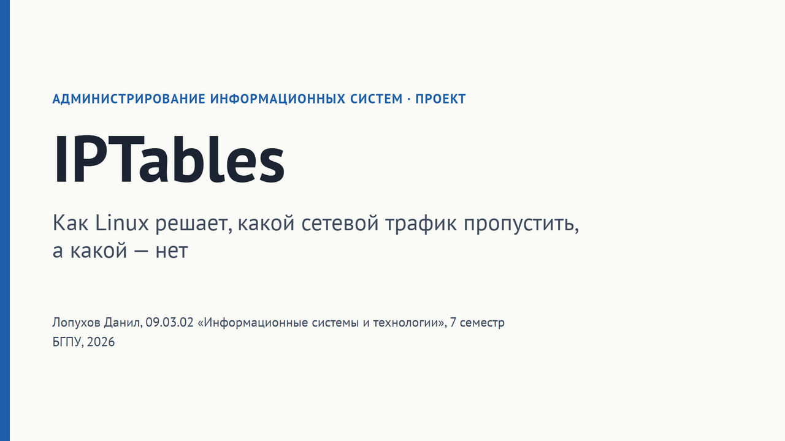

**Текст выступления.** Здравствуйте. Тема моего доклада — iptables. Это инструмент, с помощью которого в Linux настраивают межсетевой экран, то есть решают, какой сетевой трафик пропускать к компьютеру, а какой — нет. Я расскажу, зачем это нужно, как iptables устроен внутри, покажу практический пример защиты сервера и разберу типичные ошибки, которые допускают при настройке.

## Слайд 2. Сервер в сети доступен всем

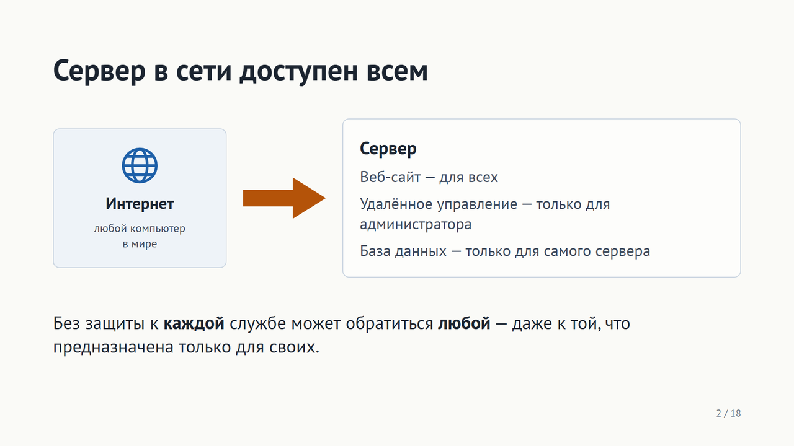

**Текст выступления.** Начнём с проблемы. Представим сервер, подключённый к интернету. На нём работает несколько служб: веб-сайт, который должен быть доступен всем; удалённое управление, которым пользуется только администратор; база данных, к которой обращается только сам сайт на этом же сервере. Но сеть сама по себе не знает, кому что можно. Если ничего не настроить, любой компьютер в интернете может попытаться подключиться к любой из этих служб: подобрать пароль администратора или обратиться к базе данных напрямую. Значит, нужен «охранник», который будет решать, какие обращения пропускать, а какие нет.

## Слайд 3. Решение — межсетевой экран

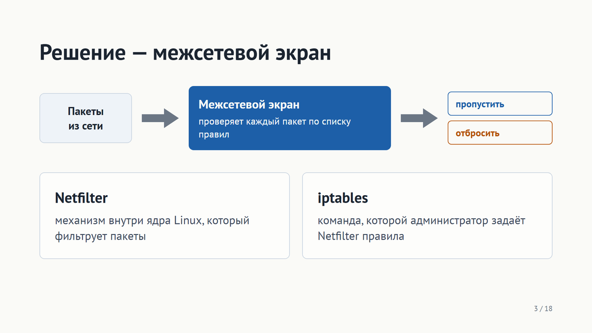

**Текст выступления.** Такого охранника называют межсетевым экраном, или файрволом. Он стоит на пути всех пакетов — так называют порции данных, на которые делится любой сетевой обмен. Для каждого пакета экран смотрит в список правил и принимает одно из двух решений: пропустить или отбросить. В Linux эта работа разделена на две части. Сама фильтрация происходит внутри ядра операционной системы, в механизме под названием Netfilter. А iptables — это команда, через которую администратор сообщает Netfilter свои правила. Поэтому, когда говорят «настроить iptables», имеют в виду именно написать правила для межсетевого экрана ядра.

## Слайд 4. Что экран знает о каждом пакете

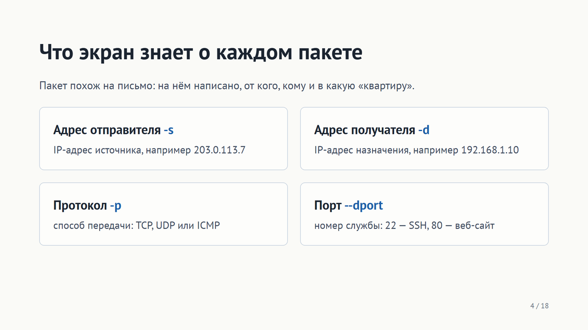

**Текст выступления.** Чтобы понять, как пишутся правила, нужно знать, что экран вообще видит в пакете. Удобно сравнить пакет с письмом. На нём указан адрес отправителя — это IP-адрес компьютера, который прислал пакет. Указан адрес получателя — IP-адрес, куда пакет идёт. Указан протокол — способ передачи: TCP для надёжных соединений, например сайтов, UDP для быстрых коротких сообщений, ICMP для служебных, например проверки связи. И указан порт — это как номер квартиры в доме: один сервер, но разные службы живут на разных портах. Например, удалённое управление по SSH — порт 22, веб-сайт — порт 80. Рядом с каждым полем синим я подписал ключ команды iptables, которым это поле проверяется. Именно из этих ключей и собираются правила.

## Слайд 5. Правило = где + условие + действие

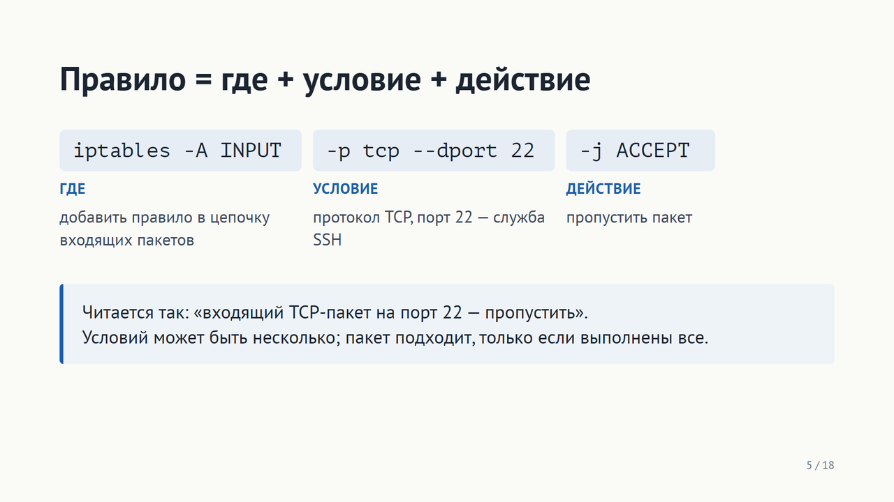

**Текст выступления.** Любое правило iptables состоит из трёх частей. Первая — где оно действует. Ключ «минус A» означает «добавить в конец», а INPUT — это цепочка, через которую проходят входящие пакеты; про цепочки я расскажу чуть позже. Вторая часть — условие, то есть какие пакеты нас интересуют. Здесь: протокол TCP и порт назначения 22, то есть подключения к удалённому управлению SSH. Третья часть — действие, ключ «минус j», от английского jump, «перейти». ACCEPT значит «пропустить». В итоге правило читается обычной фразой: входящий TCP-пакет на порт 22 — пропустить. Условий в одном правиле может быть несколько, например ещё и адрес отправителя, и тогда правило сработает, только если выполнены все условия сразу.

## Слайд 6. Четыре главных действия

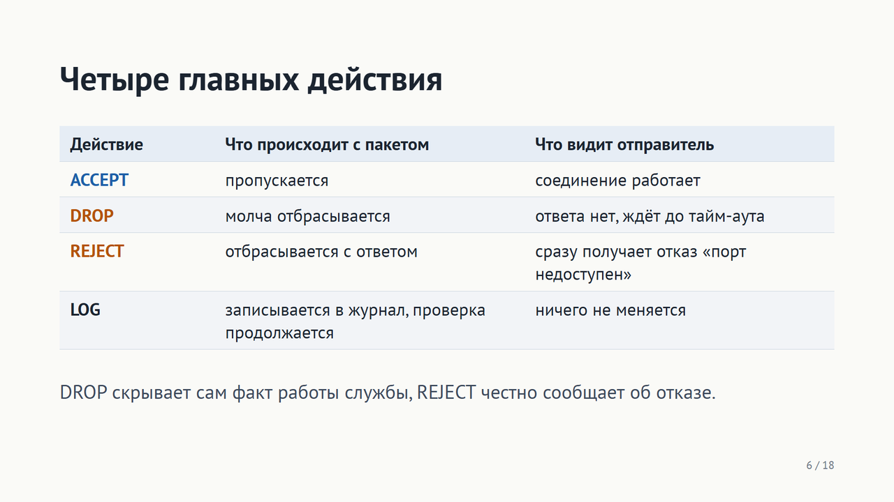

**Текст выступления.** Действий у iptables много, но в повседневной работе хватает четырёх. ACCEPT — пакет пропускается. DROP — пакет молча выбрасывается: отправитель не получает никакого ответа и просто ждёт, пока не истечёт время ожидания. REJECT — пакет тоже не проходит, но отправителю сразу приходит служебное сообщение, что порт недоступен. Отсюда выбор: DROP не выдаёт, что на этом адресе вообще что-то работает, поэтому его используют против посторонних из интернета; REJECT удобнее внутри своей сети, потому что программы сразу понимают, что доступ закрыт, и не зависают. Четвёртое действие, LOG, особенное: оно ничего не решает, а только записывает информацию о пакете в системный журнал, и проверка идёт дальше. Его используют, чтобы видеть, кто пытался подключиться.

## Слайд 7. Цепочки: где проверяется пакет

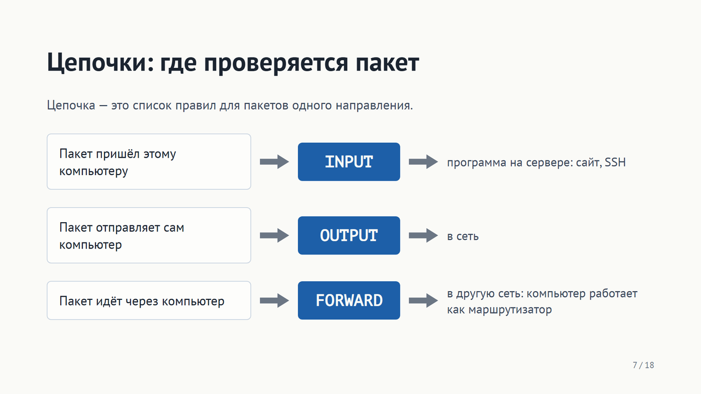

**Текст выступления.** Правила не лежат одной кучей, а разложены по цепочкам. Цепочка — это список правил для пакетов определённого направления. Основных цепочек три. INPUT — для пакетов, адресованных самому компьютеру: например, кто-то открывает сайт на нашем сервере. OUTPUT — для пакетов, которые компьютер отправляет сам. FORWARD — для пакетов, которые просто проходят через компьютер из одной сети в другую; так бывает, когда Linux работает маршрутизатором, например раздаёт интернет локальной сети. Каждый пакет попадает только в ту цепочку, которая соответствует его направлению. Поэтому для защиты сервера от входящих подключений правила пишут в цепочку INPUT.

## Слайд 8. Правила проверяются сверху вниз

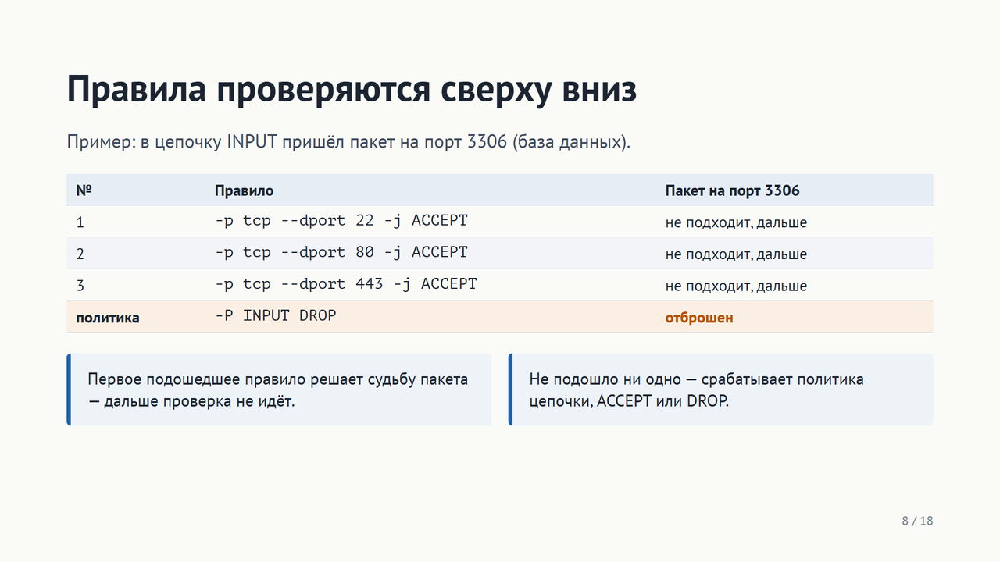

**Текст выступления.** Теперь самое важное правило работы iptables — порядок проверки. Правила в цепочке проверяются строго сверху вниз. Как только пакет подошёл под какое-то правило с решающим действием, например ACCEPT или DROP, его судьба решена, и следующие правила уже не смотрятся. А если пакет не подошёл ни под одно правило, срабатывает политика цепочки — действие по умолчанию, которое задаётся ключом «минус P». Посмотрим на пример. В цепочке разрешены порты 22, 80 и 443, а политика — DROP. Приходит пакет на порт 3306, это порт базы данных. Он не подходит под первое правило, под второе, под третье, и в итоге срабатывает политика: пакет отброшен. То есть база данных снаружи недоступна, хотя отдельного запрещающего правила для неё мы не писали. Из-за этого порядок правил имеет значение, и к этому я ещё вернусь, когда буду говорить об ошибках.

## Слайд 9. Таблицы: каждая для своей задачи

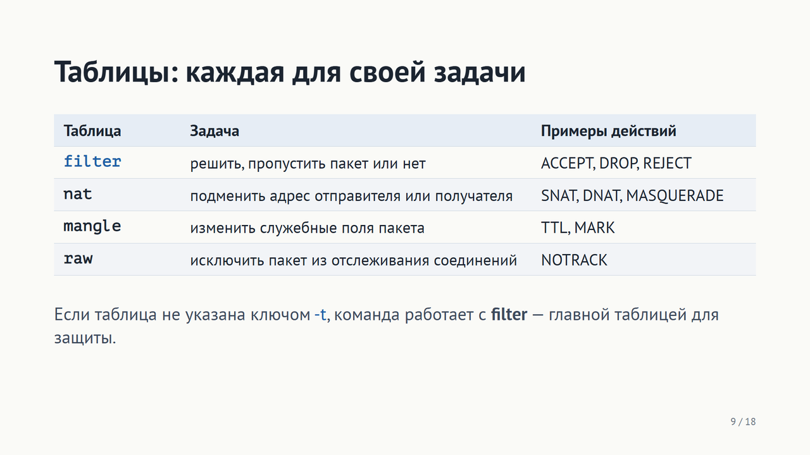

**Текст выступления.** Цепочки, в свою очередь, сгруппированы в таблицы. Таблица определяет, какую задачу мы решаем. Таблица filter — для фильтрации, то есть ровно то, о чём я говорил до сих пор: пропустить или отбросить. Таблица nat — для подмены адресов; она нужна, например, чтобы несколько компьютеров выходили в интернет через один внешний адрес, и я покажу это позже. Таблица mangle меняет служебные поля пакета, например время жизни TTL или внутреннюю метку. Таблица raw позволяет исключить пакеты из отслеживания соединений. Для защиты сервера в большинстве случаев нужна только таблица filter, и она используется по умолчанию: если в команде не указан ключ «минус t», правило попадает именно в filter. Поэтому во всех примерах этого доклада, кроме NAT, таблица не указывается.

## Слайд 10. Состояние соединения

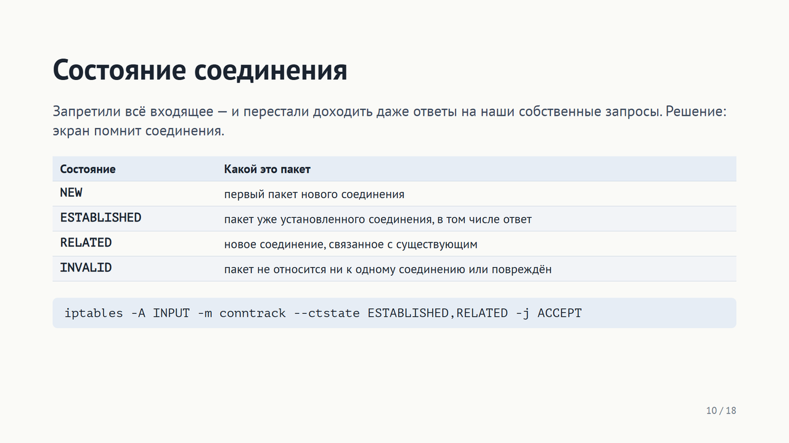

**Текст выступления.** Есть одна тонкость. Допустим, мы запретили все входящие пакеты, кроме нескольких портов. Сервер хочет скачать обновления из интернета: он сам отправляет запрос, а ответ приходит как входящий пакет — и отбрасывается. Получается, что мы сломали работу самого сервера. Чтобы этого не было, Netfilter отслеживает соединения и знает состояние каждого пакета. NEW — первый пакет нового соединения. ESTABLISHED — пакет уже установленного соединения, в том числе ответ на наш запрос. RELATED — новое соединение, которое связано с уже существующим; классический пример — отдельный канал передачи данных в протоколе FTP. INVALID — пакет, который не относится ни к одному известному соединению или повреждён. Правило внизу слайда пропускает пакеты в состояниях ESTABLISHED и RELATED, то есть все ответы на то, что начали мы сами. Такое правило ставят одним из первых в любой конфигурации. В лекции то же самое записано через модуль state — «минус m state минус минус state»; модуль conntrack — его более современная замена, результат одинаковый.

## Слайд 11. Пример: защищаем веб-сервер

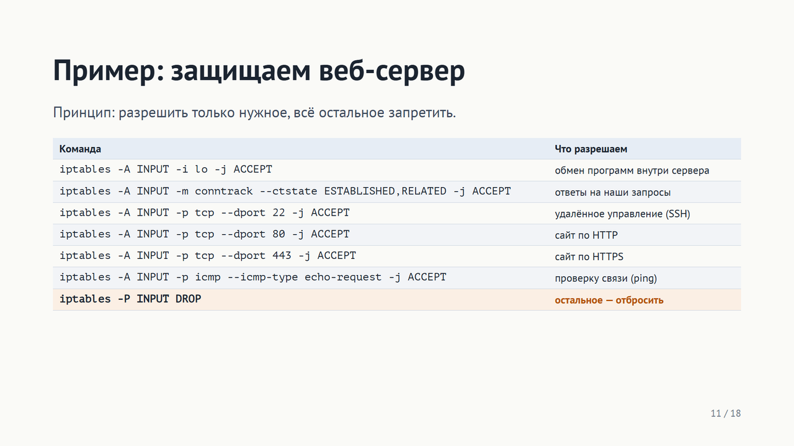

**Текст выступления.** Соберём всё вместе на практическом примере: защитим веб-сервер из начала доклада. Принцип такой: разрешаем только то, что действительно нужно, а всё остальное запрещаем. Первая строка разрешает интерфейс lo — это внутренний обмен между программами на самом сервере, например сайта с базой данных; если его закрыть, сервер перестанет работать сам с собой. Вторая — уже знакомое правило для ответов на наши запросы. Третья открывает SSH, чтобы администратор мог управлять сервером удалённо. Четвёртая и пятая открывают сайт: порт 80 — обычный HTTP, порт 443 — защищённый HTTPS. Шестая разрешает ping, чтобы можно было проверить, что сервер на связи. И последняя строка устанавливает политику DROP: всё, что не подошло под правила выше, отбрасывается. В результате база данных, которая была открыта всему интернету, теперь снаружи недоступна. Обратите внимание: политика DROP ставится последней. Почему это важно — расскажу на слайде об ошибках.

## Слайд 12. Управление правилами и проверка

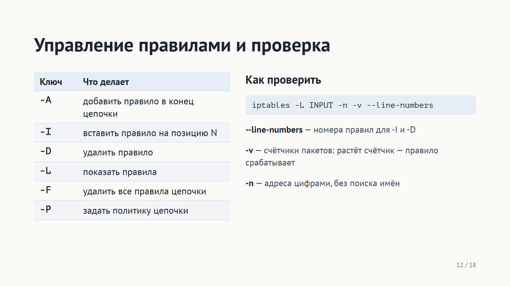

**Текст выступления.** Для работы с правилами есть небольшой набор ключей. «Минус A» добавляет правило в конец цепочки. «Минус I» вставляет правило на нужную позицию — это важно, потому что порядок правил определяет результат. «Минус D» удаляет правило, «минус L» показывает список, «минус F» очищает цепочку, «минус P» задаёт политику. Чтобы проверить, как работает защита, используют команду справа. Ключ line-numbers выводит номер каждого правила — по этому номеру правило можно удалить или вставить новое перед ним. Ключ «минус v» добавляет счётчики: сколько пакетов и байт подошло под каждое правило. Если счётчик растёт, значит правило действительно срабатывает; если стоит на нуле — пакеты до него не доходят, и, возможно, их перехватывает правило выше. Ключ «минус n» выводит адреса и порты цифрами, без попыток узнать имена, поэтому список выводится сразу.

## Слайд 13. Правила живут до перезагрузки

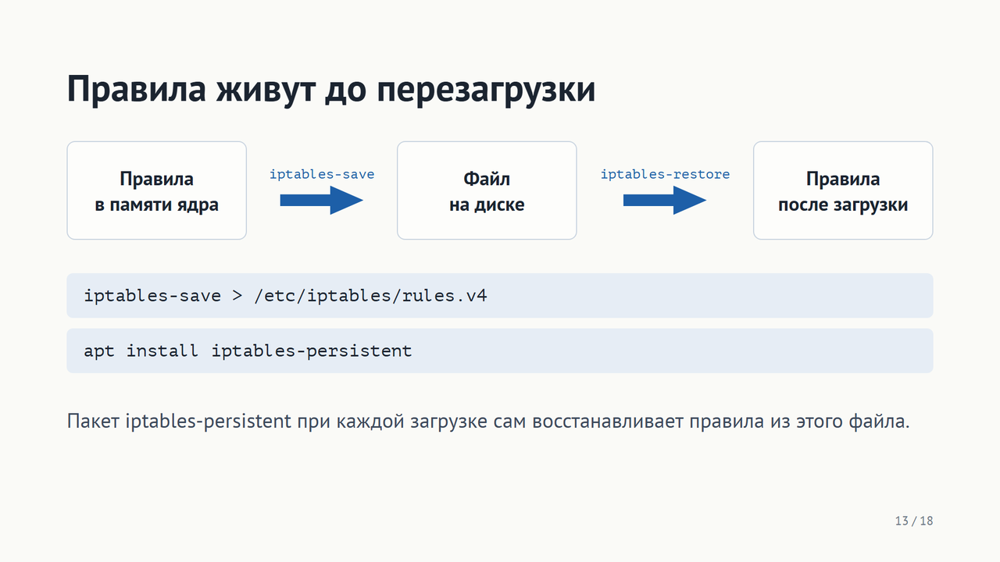

**Текст выступления.** Важная особенность, о которой часто забывают: правила, введённые командой iptables, хранятся только в памяти ядра. После перезагрузки они исчезают, и сервер остаётся без защиты. Чтобы этого не произошло, правила сохраняют в файл командой iptables-save, а при загрузке системы загружают обратно командой iptables-restore. В Debian и Ubuntu для этого есть готовый пакет iptables-persistent: он хранит правила в файле /etc/iptables/rules.v4 и при каждой загрузке восстанавливает их сам. Все эти команды выполняются от имени администратора, то есть root.

## Слайд 14. NAT: вся сеть выходит через один адрес

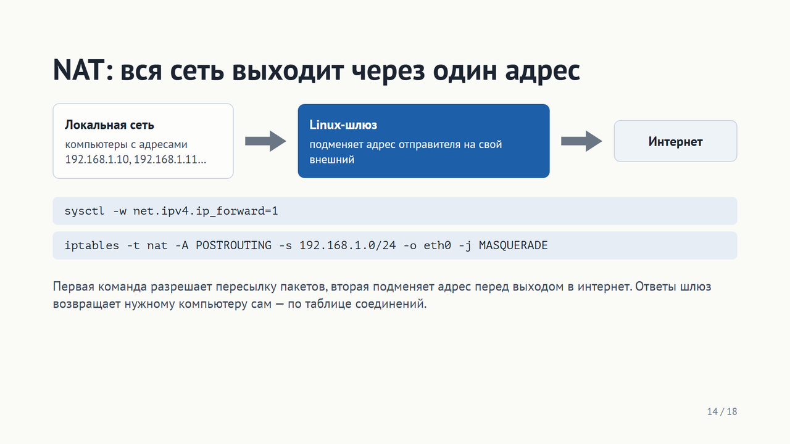

**Текст выступления.** Вторая типичная задача iptables, кроме защиты, — NAT, преобразование адресов. Компьютеры в локальной сети, например дома или в компьютерном классе, имеют внутренние адреса вида 192.168.1.10. В интернете такие адреса не используются, поэтому напрямую выйти в сеть эти компьютеры не могут. Решение: Linux-компьютер становится шлюзом. Первая команда разрешает ему пересылать пакеты между сетями — по умолчанию Linux этого не делает. Вторая команда добавляет правило в таблицу nat, в цепочку POSTROUTING, которая срабатывает непосредственно перед отправкой пакета в сеть. Действие MASQUERADE заменяет адрес отправителя на внешний адрес шлюза, то есть интерфейса eth0. Для интернета все компьютеры сети выглядят как один. А когда приходит ответ, шлюз по той же таблице отслеживания соединений понимает, какому компьютеру он предназначен, и возвращает адрес обратно.

## Слайд 15. Четыре типичные ошибки

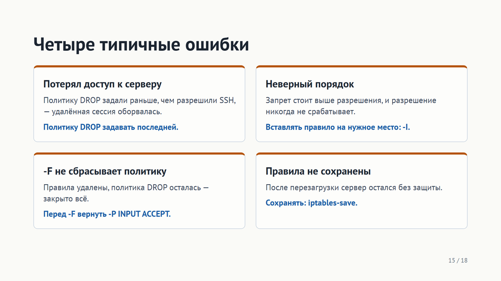

**Текст выступления.** Теперь о типичных ошибках — каждая из них встречается на практике и приводит к реальным проблемам. Первая: администратор подключён к серверу удалённо по SSH и первым делом ставит политику DROP. В этот же момент его собственная сессия перестаёт проходить, и доступ к серверу потерян — придётся ехать к нему физически. Поэтому политику DROP задают последней, когда SSH уже разрешён; именно так сделано в примере. Вторая: неверный порядок. Если запрещающее правило стоит выше разрешающего, разрешение никогда не сработает, ведь решает первое совпадение. Нужное правило вставляют на правильное место ключом «минус I». Третья, менее очевидная: команда «минус F» удаляет все правила, но не меняет политику. Если политика была DROP, после очистки закрыто абсолютно всё. Поэтому перед очисткой политику возвращают в ACCEPT. Четвёртая: правила забыли сохранить, и после перезагрузки сервер оказался без защиты.

## Слайд 16. iptables сегодня

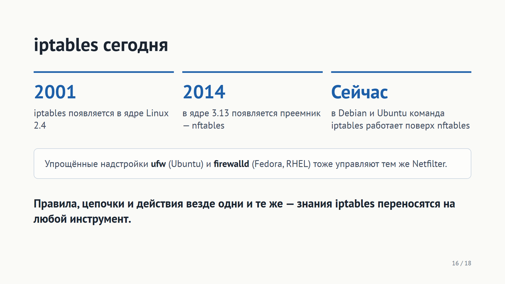

**Текст выступления.** Остаётся вопрос: актуален ли iptables сегодня? iptables появился в ядре Linux версии 2.4 в 2001 году. В 2014 году, в ядре 3.13, появился его преемник — nftables, с более удобным единым синтаксисом. Сейчас в Debian и Ubuntu привычная команда iptables по умолчанию работает поверх nftables: администратор пишет правила как раньше, а ядро выполняет их новым механизмом. Кроме того, есть упрощённые надстройки: ufw в Ubuntu и firewalld в Fedora и Red Hat. Они позволяют открыть порт одной короткой командой, но внутри управляют тем же Netfilter. Главное: понятия правила, цепочки, действия и политики одинаковы во всех этих инструментах. Поэтому, разобравшись в iptables, можно работать с любым из них.

## Слайд 17. Выводы

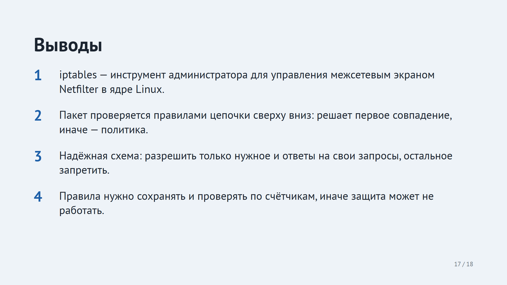

**Текст выступления.** Подведу итоги. Первое: iptables — это инструмент, с помощью которого администратор задаёт правила межсетевому экрану Netfilter, встроенному в ядро Linux. Второе: каждый пакет проверяется правилами своей цепочки строго сверху вниз; судьбу пакета решает первое подошедшее правило, а если не подошло ни одно — политика цепочки. Третье: надёжная схема защиты — разрешить только нужные службы и ответы на собственные запросы сервера, а всё остальное запретить политикой DROP. И четвёртое: правила нужно сохранять, чтобы они пережили перезагрузку, и проверять по счётчикам, что они действительно срабатывают. Спасибо за внимание, готов ответить на вопросы.

## Слайд 18. Источники

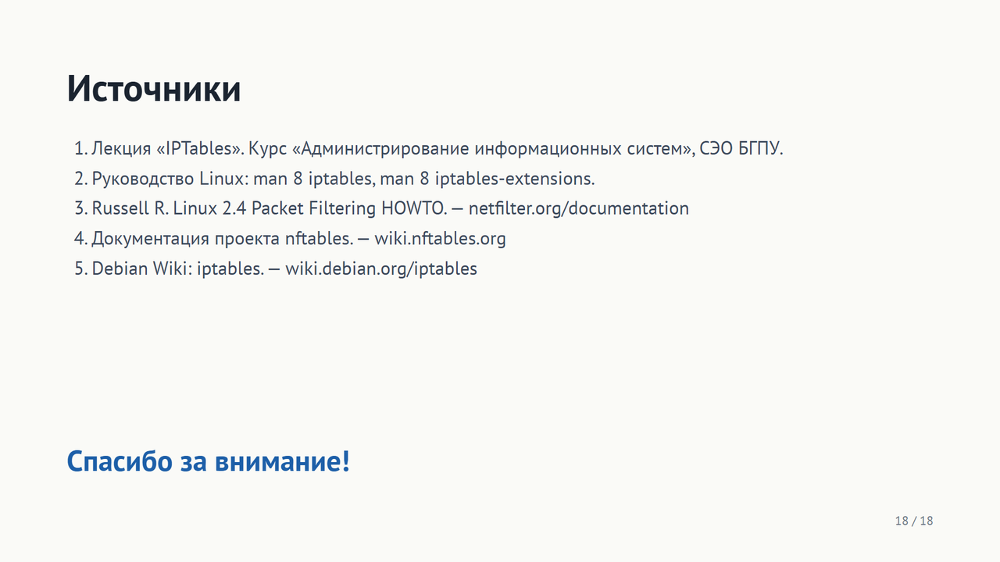

**Текст выступления.** При подготовке я опирался на лекцию курса по iptables, на официальное руководство Linux — страницы man для iptables и его расширений, на руководство по фильтрации пакетов от автора Netfilter Расти Рассела, на документацию nftables и на вики Debian. Спасибо за внимание.
